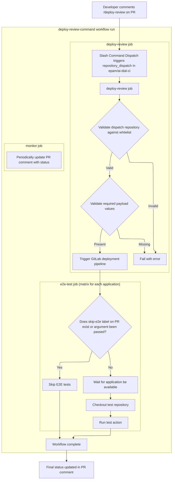

# AI DIAL workflows

- [AI DIAL workflows](#ai-dial-workflows)
  - [Overview](#overview)
  - [Usage](#usage)
    - [Repository configuration](#repository-configuration)
      - [Repository variables](#repository-variables)
      - [Repository secrets](#repository-secrets)
    - [Branching](#branching)
      - [Skipping Release Candidates (RC)](#skipping-release-candidates-rc)
    - [Changelog Generation](#changelog-generation)
      - [Filters and transformers](#filters-and-transformers)
    - [NodeJS (npm)](#nodejs-npm)
      - [Requirements](#requirements)
      - [PR Workflow](#pr-workflow)
      - [Release Workflow](#release-workflow)
    - [Java (gradle)](#java-gradle)
      - [Requirements](#requirements-1)
      - [PR Workflow (Docker)](#pr-workflow-docker)
      - [Release Workflow (Docker)](#release-workflow-docker)
      - [Dependency Review](#dependency-review)
    - [Python (Poetry)](#python-poetry)
      - [Requirements](#requirements-2)
      - [PR Workflow (Docker)](#pr-workflow-docker-1)
      - [Release Workflow (Docker)](#release-workflow-docker-1)
      - [PR Workflow (package)](#pr-workflow-package)
      - [Release Workflow (package)](#release-workflow-package)
    - [Python (UV)](#python-uv)
      - [Requirements](#requirements-3)
      - [PR Workflow (Docker)](#pr-workflow-docker-2)
      - [Release Workflow (Docker)](#release-workflow-docker-2)
      - [PR Workflow (package)](#pr-workflow-package-1)
      - [Release Workflow (package)](#release-workflow-package-1)
    - [Generic Docker](#generic-docker)
      - [Requirements](#requirements-4)
      - [PR Workflow](#pr-workflow-1)
      - [Release Workflow](#release-workflow-1)
    - [Others](#others)
      - [Validate PR title](#validate-pr-title)
      - [Deploy review environment](#deploy-review-environment)
        - [End-to-end tests](#end-to-end-tests)
          - [Test Repository Structure](#test-repository-structure)
          - [Skipping E2E Tests](#skipping-e2e-tests)
      - [Cleanup untagged images in GHCR](#cleanup-untagged-images-in-ghcr)
      - [Trigger deployment of development environment in GitLab](#trigger-deployment-of-development-environment-in-gitlab)
      - [Trivy additional configuration](#trivy-additional-configuration)
      - [SCA scheduled scan](#sca-scheduled-scan)
        - [Repository configuration of the SCA scan](#repository-configuration-of-the-sca-scan)
        - [OSV in the SCA scheduled scan](#osv-in-the-sca-scheduled-scan)
        - [Early warning in the SCA scheduled scan](#early-warning-in-the-sca-scheduled-scan)
        - [CVE index for the early warning](#cve-index-for-the-early-warning)
      - [Dependabot](#dependabot)
        - [Dependabot Pull Requests Automation](#dependabot-pull-requests-automation)
      - [ORT](#ort)
        - [Control switches](#control-switches)
        - [Configuration](#configuration)
          - [Global config repository](#global-config-repository)
          - [.ort.yml](#ortyml)
  - [Contributing](#contributing)

## Overview

Continuous Integration instrumentation for [AI DIAL](https://dialx.ai) components.

Contains reusable workflows for AI-DIAL group of repositories under EPAM GitHub organization.

## Usage

These workflows could be imported to any repository under EPAM GitHub organization as standard `.github/workflows` files. See examples below (replace `@main` with specific version tag).

### Repository configuration

#### Repository variables

> [!tip]
> [Creating configuration variables for a repository](https://docs.github.com/en/actions/how-tos/write-workflows/choose-what-workflows-do/use-variables#creating-configuration-variables-for-a-repository)

| Name                | Example value                                        | Required | Description                         |
| ------------------- | ---------------------------------------------------- | -------- | ----------------------------------- |
| `ACTIONS_BOT_NAME`  | `ai-dial-actions`                                    | false    | Git user name for CI/CD automation  |
| `ACTIONS_BOT_EMAIL` | `149404362+ai-dial-actions@users.noreply.github.com` | false    | Git user email for CI/CD automation |

#### Repository secrets

> [!tip]
> [Creating secrets for a repository](https://docs.github.com/en/actions/how-tos/write-workflows/choose-what-workflows-do/use-secrets#creating-secrets-for-a-repository)

| Name                | Example value                    | Required | Description                                                                          |
| ------------------- | -------------------------------- | -------- | ------------------------------------------------------------------------------------ |
| `ACTIONS_BOT_TOKEN` | `ghp_1234567890abcdef1234567890` | true     | Personal access token for CI/CD automation user with `repo`, `write:packages` scopes |

### Branching

We expect consumer repositories to follow the given branching strategy:

1. A `development` is the branch for all new work
1. All code changes are merged from feature branches to `development` via pull requests
1. When there's enough changes in `development` for a new release, maintainer cuts `release-X.Y` branch. Release enters stabilization phase, the branch produce numbered RC artifacts (`X.Y.0-rc.N`)
1. Once the maintainer decides the release is stable, he manually (`workflow_dispatch`) triggers `Release Workflow` for `release-X.Y` branch with `promote` option set. Stable `X.Y.0` is published
1. Since that moment, `release-X.Y` enters maintenance phase, and any subsequent pushes to that branch produce patches (`X.Y.1`, `X.Y.2`, ...)
1. Fixes to maintenance branches must be backported from `development` branch via cherry-picks

More details can be found in [Branching Strategy](docs/BRANCHING_STRATEGY.md)

#### Skipping Release Candidates (RC)

In some cases, maintainers may want to skip Release Candidate (RC) phase and produce stable versions directly from `release-X.Y` branches. For example, if repository produce package(s) as build artifacts, and no strict QA/verification process is required.

To achieve that, replace `workflow_dispatch` input approach with static `true` value for `promote` input in `Release Workflow`

<details>
<summary>Example</summary>

```diff
name: Release Workflow

on:
  push:
    branches: [development, release-*]
  workflow_dispatch:
-   inputs:
-     promote:
-       type: boolean
-       default: false
-       description: Promote release to stable (for release-* branches only)

concurrency:
  group: ${{ github.workflow }}-${{ github.ref }}
  cancel-in-progress: true

jobs:
  release:
    uses: epam/ai-dial-ci/.github/workflows/python_package_release.yml@main
    with:
-     promote: ${{ github.event_name == 'workflow_dispatch' && inputs.promote }}
+     promote: true
    secrets: inherit
```

</details>

### Changelog Generation

Changelog is automatically generated based on git commit history (commit messages) and added to git tags and GitHub releases description

| Scenario                          | Baseline                   | Scope                                                                      |
| --------------------------------- | -------------------------- | -------------------------------------------------------------------------- |
| First RC (`X.Y.0-rc.0`)           | Latest global stable tag   | Commits since latest stable tag (full history if no stable tag exists)     |
| Subsequent RC (`X.Y.0-rc.N`, N>0) | Previous RC tag            | Commits since previous RC tag only                                         |
| Stable promotion (`X.Y.0`)        | Latest global stable tag   | Commits on release branch since cut (full history if no stable tag exists) |
| Patch version (`X.Y.1+`)          | Previous patch version tag | Commits since previous patch only                                          |

#### Filters and transformers

- Deduplication: the changelog uses two layers to prevent duplicate changelog entries:
  - patch-ID comparison (`git log --cherry-pick`): catches cherry-picks with identical changes
  - commit-message matching: catches conflict-resolved or amended cherry-picks
- `[skip ci] Update version` commits are excluded from the changelog. They are typically generated by the release workflow and don't contain user-facing changes
- `Merge branch` commits are excluded from the changelog
- Changelog entries are grouped by type: `Features`, `Fixes`, `Other`. `Breaking changes` are highlighted as a separate section at the top

### NodeJS (npm)

> [!tip]
> Workflows allow independent choices of build artifacts: container image, npm package, or both (default). Can be controlled via `docker-build-enabled` and `publish-enabled` inputs respectively. Set inputs values to match your repository needs.

#### Requirements

Consumer repository **must** have:

- `package.json` file with `format`, `lint`, `test`, `build` scripts defined. We require scripts to exist, but not restrict their implementation - you can use any tools you like.

  <details>
    <summary>Example</summary>

    ```json
    {
      "name": "@scope/my-package",
      "version": "0.0.0",
      "scripts": {
        "format": "prettier --check .",
        "lint": "eslint .",
        "test": "jest",
        "build": "nx run-many -t build",
      }
    }
    ```

    > [!warning]
    > The `version` value is updated by CI/CD automation - please do not modify it manually. See more details in [Branching](#branching) section

    > [!tip]
    > If a `build:publishable` script exists, it takes precedence over `build` for building the package. Useful in monorepos to avoid building the whole repository when only subset should be published, e.g. `"build:publishable": "nx run-many -t build --projects=tag:publishable"`

    > [!tip]
    > If a `publish:npm` script exists, it takes precedence over regular `npm publish` command for publishing the package. This allows to implement any custom publish logic. The custom script will receive desired distribution tag as a `--tag` argument
  </details>

- Authentication to npm registry

  While publishing a package to [npm registry](https://npmjs.com), we support 2 options how to provide credentials.

  - (recommended) [Trusted publishing](https://docs.npmjs.com/trusted-publishers): grant release GitHub workflow `id-token: write` permission (see [example](#release-workflow))
  - [Granular access token](https://docs.npmjs.com/creating-and-viewing-access-tokens): create a token and store it as `NPM_TOKEN` [repository secret](https://docs.github.com/en/actions/security-guides/encrypted-secrets)

#### PR Workflow

`pr.yml`

```yml
name: PR Workflow

on:
  pull_request:
    branches: [development, release-*]

concurrency:
  group: ${{ github.workflow }}-${{ github.event.pull_request.number }}
  cancel-in-progress: true

jobs:
  run_tests:
    uses: epam/ai-dial-ci/.github/workflows/node_pr.yml@main
    secrets: inherit
```

#### Release Workflow

`release.yml`

```yml
name: Release Workflow

on:
  push:
    branches: [development, release-*]
  workflow_dispatch:
    inputs:
      promote:
        type: boolean
        default: false
        description: Promote release to stable (for release-* branches only)

concurrency:
  group: ${{ github.workflow }}-${{ github.ref }}
  cancel-in-progress: true

permissions:
  contents: write
  packages: write
  security-events: write
  id-token: write

jobs:
  release:
    uses: epam/ai-dial-ci/.github/workflows/node_release.yml@main
    with:
      promote: ${{ github.event_name == 'workflow_dispatch' && inputs.promote }}
    secrets: inherit
```

### Java (gradle)

#### Requirements

Consumer repository **must** have:

- `build.gradle` with `check`, `checkstyleMain` and `build` tasks exposed

  <details>
    <summary>Example</summary>

  ```groovy
  plugins {
      id "java" // exposes `check`, `build` tasks
      id "checkstyle" // exposes `checkstyleMain` task
  }

  group = "org.example"
  version = "0.0.0"
  ```

  > [!warning]
  > The `version` value is updated by CI/CD automation - please do not modify it manually. See more details in [Branching](#branching) section
  </details>

#### PR Workflow (Docker)

`pr.yml`

```yml
name: PR Workflow

on:
  pull_request:
    branches: [development, release-*]

concurrency:
  group: ${{ github.workflow }}-${{ github.event.pull_request.number }}
  cancel-in-progress: true

jobs:
  run_tests:
    uses: epam/ai-dial-ci/.github/workflows/java_pr.yml@main
    secrets: inherit
```

#### Release Workflow (Docker)

`release.yml`

```yml
name: Release Workflow

on:
  push:
    branches: [development, release-*]
  workflow_dispatch:
    inputs:
      promote:
        type: boolean
        default: false
        description: Promote release to stable (for release-* branches only)

concurrency:
  group: ${{ github.workflow }}-${{ github.ref }}
  cancel-in-progress: true

jobs:
  release:
    uses: epam/ai-dial-ci/.github/workflows/java_release.yml@main
    with:
      promote: ${{ github.event_name == 'workflow_dispatch' && inputs.promote }}
    secrets: inherit
```

#### Dependency Review

Without a dependency graph, GitHub has no visibility into what packages the Java project uses - so it can't warn when one of them has a known vulnerability (CVE).\
The dependency graph snapshot is generated automatically as part of [PR Workflow](#pr-workflow-docker) and [Release Workflow](#release-workflow-docker) via integration with the [GitHub Dependency Graph Gradle Plugin](https://plugins.gradle.org/plugin/org.gradle.github-dependency-graph-gradle-plugin), and submitted via the [GitHub Dependency Submission API](https://docs.github.com/en/rest/dependency-graph/dependency-submission).\
The generated dependency graph includes all of the dependencies, and is used by GitHub to generate [Dependabot Alerts](https://docs.github.com/en/code-security/dependabot/dependabot-alerts/about-dependabot-alerts) for vulnerable dependencies, as well as to populate the [Dependency Graph insights view](https://docs.github.com/en/code-security/supply-chain-security/understanding-your-software-supply-chain/exploring-the-dependencies-of-a-repository#viewing-the-dependency-graph).

Configuration:

1. Navigate to "Settings -> Advanced Security" and enable `Dependency graph`, `Dependabot alerts`, `Dependabot security updates` features

Additionally, repository maintainers can benefit from getting automated comments to PRs with insights on dependency changes:
<!-- markdownlint-disable-next-line no-inline-html -->


Configuration:

1. Ensure dependency graph is enabled as described above
1. Navigate to "Settings -> Actions -> General" and set "Workflow permissions" to `Read and write permissions`
1. Commit a workflow file to default branch

`dependency-review.yml`

```yml
name: Dependency Review

on:
  workflow_run:
    workflows: ["PR Workflow"]
    types:
      - completed

concurrency:
  group: ${{ github.workflow }}-${{ github.event.workflow_run.pull_requests[0].number || github.event.workflow_run.head_sha }}
  cancel-in-progress: true

permissions:
  actions: read # to download dependency graph artifact
  contents: write # to submit dependency graph
  pull-requests: read # to resolve PR info for fork PRs

jobs:
  dependency-review:
    if: |
      !github.event.repository.private &&
      github.event.workflow_run.event == 'pull_request' &&
      github.event.workflow_run.conclusion == 'success'
    runs-on: ubuntu-latest
    steps:
      - name: Harden Runner
        uses: step-security/harden-runner@e14015d583714f6e62063499dc959a02595150a1 # v2.21.1
        with:
          disable-telemetry: true
          disable-sudo-and-containers: true
          egress-policy: block
          allowed-endpoints: >
            api.github.com:443
            api.deps.dev:443
            api.securityscorecards.dev:443
      - name: Get PR
        id: get-pr
        uses: actions/github-script@3a2844b7e9c422d3c10d287c895573f7108da1b3 # v9.0.0
        with:
          retries: 3
          script: |
            const wfRun = context.payload.workflow_run;
            const pr = wfRun.pull_requests[0];
            let number, base_sha, head_sha;
            if (pr) {
              number = pr.number;
              base_sha = pr.base.sha;
              head_sha = pr.head.sha;
            } else {
              // Fork PR: pull_requests[] is empty, resolve via head branch filter
              const headLabel = `${wfRun.head_repository.owner.login}:${wfRun.head_branch}`;
              const { data: prs } = await github.rest.pulls.list({
                owner: context.repo.owner,
                repo: context.repo.repo,
                state: 'open',
                head: headLabel,
              });
              const matched = prs[0];
              if (!matched) throw new Error(`No open PR found for head ${headLabel}`);
              number = matched.number;
              base_sha = matched.base.sha;
              head_sha = wfRun.head_sha;
            }
            core.info(`is_fork:  ${pr ? 'false' : 'true'}`);
            core.info(`number:   ${number}`);
            core.info(`base_sha: ${base_sha}`);
            core.info(`head_sha: ${head_sha}`);
            core.setOutput('is_fork', pr ? 'false' : 'true');
            core.setOutput('number', number);
            core.setOutput('base_sha', base_sha);
            core.setOutput('head_sha', head_sha);
      - name: Download and submit dependency graph
        uses: gradle/actions/dependency-submission@f29f5a9d7b09a7c6b29859002d29d24e1674c884 # v5.0.1
        with:
          dependency-graph: download-and-submit
      - id: dependency-review
        uses: actions/dependency-review-action@a1d282b36b6f3519aa1f3fc636f609c47dddb294 # v5.0.0
        with:
          retry-on-snapshot-warnings: true
          retry-on-snapshot-warnings-timeout: 600 # let GitHub process both graphs up to 10 minutes
          base-ref: ${{ steps.get-pr.outputs.base_sha }}
          head-ref: ${{ steps.get-pr.outputs.head_sha }}
          warn-only: true # we don't want to fail the workflow, just to report the issues via comment
          show-patched-versions: true
      - if: ${{ steps.dependency-review.outputs.comment-content != null }}
        name: Save dependency review output report
        run: |
          cat << 'EOF' > openssf-report.html
          ${{ steps.dependency-review.outputs.comment-content }}
          EOF
      - if: ${{ steps.dependency-review.outputs.comment-content != null }}
        # Use separate action to comment because the original one can't do it without PR context
        uses: marocchino/sticky-pull-request-comment@5770ad5eb8f42dd2c4f34da00c94c5381e49af88 # v3.0.5
        with:
          number: ${{ steps.get-pr.outputs.number }}
          header: dependency-review
          hide_and_recreate: true
          path: openssf-report.html
          GITHUB_TOKEN: ${{ secrets.ACTIONS_BOT_TOKEN }}
      - if: failure()
        # If the review fails, we still want to "outdate" the comment to avoid stale information
        uses: marocchino/sticky-pull-request-comment@5770ad5eb8f42dd2c4f34da00c94c5381e49af88 # v3.0.5
        with:
          number: ${{ steps.get-pr.outputs.number }}
          header: dependency-review
          hide_and_recreate: true
          message: "⚠️ Dependency review workflow failed - results may be outdated. [Check logs](${{ github.server_url }}/${{ github.repository }}/actions/runs/${{ github.run_id }})"
          GITHUB_TOKEN: ${{ secrets.ACTIONS_BOT_TOKEN }}
```

### Python (Poetry)

#### Requirements

Consumer repository **must** have:

- `Makefile` file with `lint`, `build` (only for Python packages), `test`, `publish` (only for Python packages) targets defined

  <details>
    <summary>Example</summary>

  ```makefile
  PORT ?= 5001

  .PHONY: install lint build test publish

  install:
    poetry install --all-extras

  lint: install
    poetry run ruff check .
    poetry run ruff format --check .

  build: install # Required only for Python packages
    poetry build

  test: install
    if [ -n "$(PYTHON)" ]; then poetry env use "$(PYTHON)"; fi
    poetry run pytest

  publish: # Required only for Python packages
    poetry publish --username __token__ --password $(PYPI_TOKEN) --skip-existing
  ```

  > [!note]
  > `build` and `publish` Makefile targets are required only for repositories that produce Python packages as build artifacts

  > [!tip]
  > `test` target receives Python version, e.g. `make test PYTHON=<version>`, where `<version>` is the one defined in `code-checks-python-versions` workflow input. If multiple versions are defined, the workflow will run tests for each of them in parallel
  </details>

- `pyproject.toml` file with `name` and `version` defined

  <details>
    <summary>Example</summary>

  ```toml
  [project]
  name = "my-package"
  version = "0.0.0"
  ```

  > [!warning]
  > The `version` value is updated by CI/CD automation - please do not modify it manually. See more details in [Branching](#branching) section
  </details>

#### PR Workflow (Docker)

`pr.yml`

```yml
name: PR Workflow

on:
  pull_request:
    branches: [development, release-*]

concurrency:
  group: ${{ github.workflow }}-${{ github.event.pull_request.number }}
  cancel-in-progress: true

jobs:
  run_tests:
    uses: epam/ai-dial-ci/.github/workflows/python_docker_pr.yml@main
    secrets: inherit
```

#### Release Workflow (Docker)

`release.yml`

```yml
name: Release Workflow

on:
  push:
    branches: [development, release-*]
  workflow_dispatch:
    inputs:
      promote:
        type: boolean
        default: false
        description: Promote release to stable (for release-* branches only)

concurrency:
  group: ${{ github.workflow }}-${{ github.ref }}
  cancel-in-progress: true

jobs:
  release:
    uses: epam/ai-dial-ci/.github/workflows/python_docker_release.yml@main
    with:
      promote: ${{ github.event_name == 'workflow_dispatch' && inputs.promote }}
    secrets: inherit
```

#### PR Workflow (package)

`pr.yml`

```yml
name: PR Workflow

on:
  pull_request:
    branches: [development, release-*]

concurrency:
  group: ${{ github.workflow }}-${{ github.event.pull_request.number }}
  cancel-in-progress: true

jobs:
  run_tests:
    uses: epam/ai-dial-ci/.github/workflows/python_package_pr.yml@main
    secrets: inherit
```

#### Release Workflow (package)

`release.yml`

```yml
name: Release Workflow

on:
  push:
    branches: [development, release-*]
  workflow_dispatch:
    inputs:
      promote:
        type: boolean
        default: false
        description: Promote release to stable (for release-* branches only)

concurrency:
  group: ${{ github.workflow }}-${{ github.ref }}
  cancel-in-progress: true

jobs:
  release:
    uses: epam/ai-dial-ci/.github/workflows/python_package_release.yml@main
    with:
      promote: ${{ github.event_name == 'workflow_dispatch' && inputs.promote }}
    secrets: inherit
```

### Python (UV)

> [!note]
> UV support is enabled by setting the `python-package-manager` workflow input to `uv` (defaults to `poetry`)

> [!note]
> [ORT](https://github.com/oss-review-toolkit/ort) doesn't support analyzing UV projects directly. When `python-package-manager` is set to `uv`, the `ort` job automatically exports `uv.lock` to a `requirements.txt` file (via `uv export --frozen`) before running ORT, and analyzes it as a PIP project instead. This is transparent and requires no changes to the consumer repository, aside from having `uv.lock` committed (see [Requirements](#requirements-3) below)

#### Requirements

Consumer repository **must** have:

- `Makefile` file with `lint`, `build` (only for Python packages), `test`, `publish` (only for Python packages) targets defined

  <details>
    <summary>Example</summary>

  ```makefile
  PORT ?= 5001

  .PHONY: install lint build test publish

  install:
    uv sync --all-extras

  lint: install
    uv run ruff check .
    uv run ruff format --check .

  build: install # Required only for Python packages
    uv build

  test: install
    if [ -n "$(PYTHON)" ]; then uv python pin "$(PYTHON)"; fi
    uv run pytest

  publish: # Required only for Python packages
    uv publish --username __token__ --password $(PYPI_TOKEN)
  ```

  > [!note]
  > `build` and `publish` Makefile targets are required only for repositories that produce Python packages as build artifacts

  > [!tip]
  > `test` target receives Python version, e.g. `make test PYTHON=<version>`, where `<version>` is the one defined in `code-checks-python-versions` workflow input. If multiple versions are defined, the workflow will run tests for each of them in parallel
  </details>

- `pyproject.toml` file with `name` and `version` defined

  <details>
    <summary>Example</summary>

  ```toml
  [project]
  name = "my-package"
  version = "0.0.0"
  ```

  > [!warning]
  > The `version` value is updated by CI/CD automation - please do not modify it manually. See more details in [Branching](#branching) section
  </details>

- `uv.lock` file committed to the repository (generated by running `uv lock`/`uv sync` locally)

#### PR Workflow (Docker)

`pr.yml`

```yml
name: PR Workflow

on:
  pull_request:
    branches: [development, release-*]

concurrency:
  group: ${{ github.workflow }}-${{ github.event.pull_request.number }}
  cancel-in-progress: true

jobs:
  run_tests:
    uses: epam/ai-dial-ci/.github/workflows/python_docker_pr.yml@main
    with:
      python-package-manager: uv
    secrets: inherit
```

#### Release Workflow (Docker)

`release.yml`

```yml
name: Release Workflow

on:
  push:
    branches: [development, release-*]
  workflow_dispatch:
    inputs:
      promote:
        type: boolean
        default: false
        description: Promote release to stable (for release-* branches only)

concurrency:
  group: ${{ github.workflow }}-${{ github.ref }}
  cancel-in-progress: true

jobs:
  release:
    uses: epam/ai-dial-ci/.github/workflows/python_docker_release.yml@main
    with:
      python-package-manager: uv
      promote: ${{ github.event_name == 'workflow_dispatch' && inputs.promote }}
    secrets: inherit
```

#### PR Workflow (package)

`pr.yml`

```yml
name: PR Workflow

on:
  pull_request:
    branches: [development, release-*]

concurrency:
  group: ${{ github.workflow }}-${{ github.event.pull_request.number }}
  cancel-in-progress: true

jobs:
  run_tests:
    uses: epam/ai-dial-ci/.github/workflows/python_package_pr.yml@main
    with:
      python-package-manager: uv
    secrets: inherit
```

#### Release Workflow (package)

`release.yml`

```yml
name: Release Workflow

on:
  push:
    branches: [development, release-*]
  workflow_dispatch:
    inputs:
      promote:
        type: boolean
        default: false
        description: Promote release to stable (for release-* branches only)

concurrency:
  group: ${{ github.workflow }}-${{ github.ref }}
  cancel-in-progress: true

jobs:
  release:
    uses: epam/ai-dial-ci/.github/workflows/python_package_release.yml@main
    with:
      python-package-manager: uv
      promote: ${{ github.event_name == 'workflow_dispatch' && inputs.promote }}
    secrets: inherit
```

### Generic Docker

#### Requirements

Consumer repository **must** have:

- `Makefile` with `lint` target defined

  <details>
    <summary>Example</summary>

    ```makefile
    .PHONY: all lint build run help

    all: lint build

    build:
      docker build -t my-image .

    run:
      docker run my-image

    lint:
      docker run --rm -i hadolint/hadolint < Dockerfile

    help:
      @echo '===================='
      @echo 'lint                         - lint the Dockerfile'
      @echo 'build                        - build docker image'
      @echo 'run                          - run docker image'
    ```

  </details>

- `Dockerfile`

#### PR Workflow

`pr.yml`

```yml
name: PR Workflow

on:
  pull_request:
    branches: [development, release-*]

concurrency:
  group: ${{ github.workflow }}-${{ github.event.pull_request.number }}
  cancel-in-progress: true

jobs:
  run_tests:
    uses: epam/ai-dial-ci/.github/workflows/generic_docker_pr.yml@main
    secrets: inherit
```

#### Release Workflow

`release.yml`

```yml
name: Release Workflow

on:
  push:
    branches: [development, release-*]
  workflow_dispatch:
    inputs:
      promote:
        type: boolean
        default: false
        description: Promote release to stable (for release-* branches only)

concurrency:
  group: ${{ github.workflow }}-${{ github.ref }}
  cancel-in-progress: true

jobs:
  release:
    uses: epam/ai-dial-ci/.github/workflows/generic_docker_release.yml@main
    with:
      promote: ${{ github.event_name == 'workflow_dispatch' && inputs.promote }}
    secrets: inherit
```

### Others

#### Validate PR title

`pr-title-check.yml`

```yml
name: "Validate PR title"

on:
  pull_request_target:
    types:
      - opened
      - edited
      - reopened

permissions: {}

concurrency:
  group: ${{ github.workflow }}-${{ github.event.pull_request.number }}
  cancel-in-progress: true

jobs:
  pr-title-check:
    uses: epam/ai-dial-ci/.github/workflows/pr-title-check.yml@main
    secrets:
      ACTIONS_BOT_TOKEN: ${{ secrets.ACTIONS_BOT_TOKEN }}
```

#### Deploy review environment

`slash-command-dispatch.yml`

```yml
name: Slash Command Dispatch
on:
  issue_comment:
    types: [created]
jobs:
  slashCommandDispatch:
    runs-on: ubuntu-latest
    if: |
      github.event.issue.pull_request &&
      github.event.issue.state == 'open'
    steps:
      - name: Slash Command Dispatch
        id: scd
        uses: peter-evans/slash-command-dispatch@9bdcd7914ec1b75590b790b844aa3b8eee7c683a # v5.0.2
        with:
          token: ${{ secrets.ACTIONS_BOT_TOKEN }}
          reaction-token: ${{ secrets.ACTIONS_BOT_TOKEN }}
          config: >
            [
              {
                "command": "deploy-review",
                "permission": "write",
                "issue_type": "pull-request",
                "repository": "epam/ai-dial-ci",
                "static_args": [
                  "application=${{ github.event.repository.name }}"
                ]
              }
            ]
```

##### End-to-end tests

The E2E testing system for review environments enables automated testing of pull request changes in isolated, short-lived environments. When a developer comments `/deploy-review` on a PR, the system deploys the PR code to a review environment and runs E2E tests against it. See [Skipping E2E Tests](#skipping-e2e-tests) section to disable this feature.

<details>
  <summary>Flowchart diagram</summary>



</details>

###### Test Repository Structure

A test repository must provide [composite actions](https://docs.github.com/en/actions/tutorials/create-actions/create-a-composite-action) with the following layout:

```text
.github/
  actions/
    test-<application>/
      action.yml <-- Composite action that runs tests
```

> [!important]
> One composite action should be designed to test one application only

> [!tip]
> By default, [chat](https://github.com/epam/ai-dial-chat) tests are executed. To define custom applications (with corresponding test code sources), pass `test-applications` argument in `static_args` of the `slash-command-dispatch` action. Format: `application[:test-repository],application[:test-repository]`, e.g. `chat,admin:epam/ai-dial-admin-perf` will result in running tests from `epam/ai-dial-chat` (default tests code source) against `chat` application and tests from `epam/ai-dial-admin-perf` against `admin` application

The action must have inputs:

- `application-url`: URL of the deployed review environment. Points to specific test application, e.g. chat - `https://chat-ai-dial-core-pr-123.example.com`, admin - `https://admin-ai-dial-core-pr-123.example.com`, etc
- `environment-fqdn`: FQDN of the deployed review environment (formed of repository + PR number + base domain, without protocol or application-specific prefix), e.g. `ai-dial-core-pr-123.example.com`. Useful to build additional application URLs (by prepending with protocol and well-known application prefix) on the spot besides the main one provided in `application-url`
- `report-prefix`: Environment identifier that can be used (but not limited) to prefix test reports, e.g. `ai-dial-core-pr-123`, etc
- `test-branch`: Branch name of GitHub repository with tests source code. If tests are triggered from the test repository itself, `test-branch` equals PR source branch, e.g. `feat-something-new`, otherwise empty. This behavior allows QA team to verify changes in tests before rolling them out

Besides inputs, the action will have access to environment variables:

- `E2E_ADMIN`
- `E2E_OVERLAY_USERNAME`
- `E2E_PASSWORD`
- `E2E_USERNAME`
- `NEXT_PUBLIC_OVERLAY_USER_BUCKET`
- `ADMIN_LOGIN`
- `ADMIN_PASSWORD`
- `INFLUX_HOST`
- `INFLUX_TOKEN`
- `AUTH0_DOMAIN`
- `DIAL_ADMIN_CLIENT_ID`
- `DIAL_ADMIN_NEXTAUTH_SECRET`

> [!important]
> Checkout in the composite action should be performed with great caution to avoid executing untrusted code from PRs. After checkout, `working-directory` usage is mandatory in all supported steps. See example below for recommended approach

<details>
  <summary>Example of composite action.yml</summary>

```yml
name: Example test action
description: Dummy action to demonstrate how to work with review environment context

inputs:
  # Required inputs
  application-url:
    description: "URL of the deployed review environment (specific application)"
    required: true
  environment-fqdn:
    description: "FQDN of the deployed review environment, useful to build additional application URLs"
    required: true
  report-prefix:
    description: "Prefix for report files generated by the action"
    default: ""
  test-repository:
    description: "GitHub repository with tests source code"
    default: "epam/ai-dial-chat" # TODO: modify this according to your use case
  test-branch:
    description: "Branch name of GitHub repository with tests source code"
    default: "development" # TODO: modify this according to your use case
  # Custom inputs
  working-directory:
    description: "Working directory for anything happening in the current action. Note: this is not actually an input, but a HACK to store common value as `env` is unavailable in composite actions"
    default: "tests"

runs:
  using: "composite"
  steps:
    # Checkout repository with test source code into a separate directory
    # Never use default path, otherwise you'll overwrite action code and parent workflow will fail to complete
    - uses: actions/checkout@3d3c42e5aac5ba805825da76410c181273ba90b1 # v7.0.1
      with:
        repository: ${{ inputs.test-repository }}
        ref: ${{ inputs.test-branch }}
        path: ${{ inputs.working-directory }}
        lfs: true
        persist-credentials: false
    # Dummy tests trigger
    - name: Running tests
      run: |
        echo "Running tests against ${{ inputs.application-url }}
      shell: bash
      working-directory: ${{ inputs.working-directory }}
    # Example of saving test artifacts
    - name: Upload test artifacts
      if: always()
      uses: actions/upload-artifact@043fb46d1a93c77aae656e7c1c64a875d1fc6a0a # v7.0.1
      with:
        name: ${{ inputs.report-prefix }}-test-artifacts
        path: |
          ${{ inputs.working-directory }}/*.log
        retention-days: 7
```

</details>

###### Skipping E2E Tests

If you need to disable E2E tests execution:

- for the **whole repository**: add `skip-e2e` argument to `static_args` list

  ```yml
                "static_args": [
                  "application=${{ github.event.repository.name }}",
                  "skip-e2e"
                ]
  ```

- for the **specific PR**: assign `skip-e2e` label to PR
- **once**: use `/deploy-review skip-e2e` command in PR comment

#### Cleanup untagged images in GHCR

When using "rolling" tags for container images, like `development` or `latest`, the GitHub Container Registry (GHCR) will accumulate untagged images over time. Since they're essentially useless, it's a good practice to clean them up periodically. The workflow below will delete untagged images from GHCR once a day.

> [!important]
> The workflow uses `GITHUB_TOKEN` to authenticate with GHCR by default, therefore requires **Admin** [package permissions](https://docs.github.com/en/packages/learn-github-packages/configuring-a-packages-access-control-and-visibility#github-actions-access-for-packages-scoped-to-organizations) granted to the repository.

`cleanup-untagged-images.yml`

```yml
name: Cleanup untagged images

on:
  schedule:
    - cron: "0 0 * * *"

jobs:
  clean:
    name: Delete untagged images
    runs-on: ubuntu-latest
    permissions:
      packages: write
    steps:
      - uses: dataaxiom/ghcr-cleanup-action@d52806a0dc70b430571a37da1fde39733ffd640f # v1.2.2
        with:
          delete-untagged: true
          delete-ghost-images: true # Delete indexes with no manifests
          delete-partial-images: true # Delete indexes which refer to at least one non-existent manifest
          delete-orphaned-images: true # Delete dangling referrers, e.g. SBOMs, signatures, etc. that refer to non-existent digest
```

#### Trigger deployment of development environment in GitLab

A common case is to trigger development environment(s) update from GitHub to GitLab, e.g. each time a `development` branch produces a new artifact. Also, it could be not single, but several environments, representing different configuration presets of a single app. To use the example below:

1. add a new [repository secret](https://docs.github.com/en/actions/security-guides/encrypted-secrets) with name `DEPLOY_HOST` and value of the gitlab host, e.g. `gitlab.example.com`
1. create a new [environment](https://docs.github.com/en/actions/managing-workflow-runs-and-deployments/managing-deployments/managing-environments-for-deployment#creating-an-environment), e.g. `development`
1. for the environment, add [environment secrets](https://docs.github.com/en/actions/managing-workflow-runs-and-deployments/managing-deployments/managing-environments-for-deployment#environment-secrets) with names `DEPLOY_ACCESS_TOKEN` and `DEPLOY_TRIGGER_TOKEN` and values of the gitlab access token and trigger token respectively.
1. use the example workflow file below

`deploy-development.yml`

```yml
name: Deploy development

on:
  workflow_dispatch: # manual run
  registry_package: # on new package version (main path)
  workflow_run: # HACK: redundant trigger to mitigate GitHub's huge delays in registry_package event processing
    workflows: ["Release Workflow"]
    types:
      - completed

jobs:
  gitlab-dev-deploy:
    if: |
      github.event_name == 'workflow_dispatch' ||
      github.event.registry_package.package_version.container_metadata.tag.name == 'development' ||
      (github.event.workflow_run.conclusion == 'success' && github.event.workflow_run.head_branch == 'development')
    uses: epam/ai-dial-ci/.github/workflows/deploy-development.yml@main
    with:
      gitlab-project-id: "1487"
    secrets:
      DEPLOY_HOST: ${{ secrets.DEPLOY_HOST }}
      DEPLOY_ACCESS_TOKEN: ${{ secrets.DEPLOY_ACCESS_TOKEN }}
      DEPLOY_TRIGGER_TOKEN: ${{ secrets.DEPLOY_TRIGGER_TOKEN }}
```

In case of multiple environments, continue creating multiple GitHub environments named after e.g. feature sets, each with its own secrets, then use matrix approach as shown below.

`deploy-development.yml`

```yml
name: Deploy development

on:
  workflow_dispatch: # manual run
  registry_package: # on new package version (main path)
  workflow_run: # HACK: redundant trigger to mitigate GitHub's huge delays in registry_package event processing
    workflows: ["Release Workflow"]
    types:
      - completed

jobs:
  trigger:
    if: |
      github.event_name == 'workflow_dispatch' ||
      github.event.registry_package.package_version.container_metadata.tag.name == 'development' ||
      (github.event.workflow_run.conclusion == 'success' && github.event.workflow_run.head_branch == 'development')
    strategy:
      fail-fast: false
      matrix:
        include:
          - environment-name: "development"
            gitlab-project-id: "1487"
          - environment-name: "feature-1"
            gitlab-project-id: "1489"
          - environment-name: "feature-2"
            gitlab-project-id: "1984"
          - environment-name: "feature-3"
            gitlab-project-id: "1337"

    name: Deploy to ${{ matrix.environment-name }}
    uses: epam/ai-dial-ci/.github/workflows/deploy-development.yml@main
    with:
      gitlab-project-id: ${{ matrix.gitlab-project-id }}
      environment-name: ${{ matrix.environment-name }}
    secrets:
      DEPLOY_HOST: ${{ secrets.DEPLOY_HOST }}
      DEPLOY_ACCESS_TOKEN: ${{ secrets.DEPLOY_ACCESS_TOKEN }}
      DEPLOY_TRIGGER_TOKEN: ${{ secrets.DEPLOY_TRIGGER_TOKEN }}
```

#### Trivy additional configuration

We use [Trivy](https://trivy.dev/) for vulnerability scanning of container images and packages.

To change predefined Trivy parameters or set up additional [configuration options](https://trivy.dev/docs/latest/guide/references/configuration/config-file/), create `trivy.yaml` file in root of your repository. E.g., use the configuration below to add fallback sources for Trivy databases, thus mitigate rate limit issues.

`trivy.yaml`

```yaml
# Trivy configuration file
# https://aquasecurity.github.io/trivy/latest/docs/references/configuration/config-file/
db:
  no-progress: true
  repository:
    - mirror.gcr.io/aquasec/trivy-db:2
    - public.ecr.aws/aquasecurity/trivy-db:2
    - ghcr.io/aquasecurity/trivy-db:2
  java-repository:
    - mirror.gcr.io/aquasec/trivy-java-db:1
    - public.ecr.aws/aquasecurity/trivy-java-db:1
    - ghcr.io/aquasecurity/trivy-java-db:1
misconfiguration:
  checks-bundle-repository: mirror.gcr.io/aquasec/trivy-checks:1
```

#### SCA scheduled scan

`sca_scheduled.yml` runs Software Composition Analysis of a repository on a schedule: it looks for known vulnerabilities in what the repository publishes. Today the scanner is [Trivy](https://trivy.dev/), which scans the source code of the default branch and of the latest release tag (`trivy fs`) and the published container images (`development` tag and the latest stable release). Unlike the PR checks, it is not a gate: the profile reports everything the repository is exposed to (no `.trivyignore`, unfixed vulnerabilities and all severities included, dev dependencies included), and findings never fail the run. The run fails only if a target could not be scanned. The language packages Trivy found are also checked against [OSV](https://osv.dev/) and their findings are merged into the records (`osv-enabled`, see [below](#osv-in-the-sca-scheduled-scan)), and against the CVE records of the last days for vulnerabilities that no database maps to a package yet (the "early warning", `early-warning-enabled`, see [below](#early-warning-in-the-sca-scheduled-scan)). For Gradle repositories (`gradlew` and `build.gradle(.kts)` in the root), `gradle.lockfile` files are generated on the fly together with the dependency graph Gradle resolved (see below), the repository files are not modified.

| Input                 | Type    | Default           | Description                                                                                                  |
| --------------------- | ------- | ----------------- | ------------------------------------------------------------------------------------------------------------ |
| `images`              | string  | `""`              | Image names without registry, one per line (e.g. `epam/ai-dial-chat`). Empty means source scan only         |
| `registry`            | string  | `ghcr.io`         | Registry the images are pulled from. Login with `GITHUB_TOKEN` is done for `ghcr.io` only                    |
| `repository`          | string  | calling repo      | Repository (`owner/name`) whose code is scanned and whose release is resolved. Set it when running in a fork |
| `java-version`        | string  | `21`              | Java version to generate lockfiles (Gradle repositories only)                                                |
| `java-distribution`   | string  | `temurin`         | Java distribution                                                                                            |
| `trivy-version`       | string  | `v0.75.0`         | Trivy version                                                                                                |
| `trivy-db-repository`      | string  | `mirror.gcr.io/aquasec/trivy-db:2,public.ecr.aws/aquasecurity/trivy-db:2,ghcr.io/aquasecurity/trivy-db:2` | Trivy vulnerability DB repositories, comma-separated; the next one is used on temporary registry errors (e.g. rate limiting) |
| `trivy-java-db-repository` | string  | `mirror.gcr.io/aquasec/trivy-java-db:1,public.ecr.aws/aquasecurity/trivy-java-db:1,ghcr.io/aquasecurity/trivy-java-db:1` | Trivy Java DB repositories, comma-separated; the next one is used on temporary registry errors (e.g. rate limiting) |
| `osv-enabled`         | boolean | `true`            | Also check the language packages found by Trivy against OSV and merge its findings into the report |
| `early-warning-enabled` | boolean | `true`          | Also look for CVE records that match the language packages found by Trivy but that no vulnerability database maps to a package yet. An informational section of the report, not findings; a failure of this check does not fail the run, see [below](#early-warning-in-the-sca-scheduled-scan) |
| `cve-index`           | string  | `ghcr.io/epam/ai-dial-sca-cve-index:1` | The CVE index (an OCI artifact built daily by `sca_cve_index.yml`) that the early warning reads. It is pulled anonymously, so the package must be public. Its window (180 days) is the window of the early warning |
| `retention-days`      | number  | `90`              | Retention period of the `sca-report` artifact                                                                 |
| `targets`             | string  | `""`              | Scan only the targets whose `id` matches one of these patterns (comma- or newline-separated, `*` and `?` work: `source-*`, `ai-dial-chat-1.1.14`); empty means all. A pattern that matches no target is an error. Makes the run a partial one, see `run_kind` below |
| `scan-source`         | boolean | `true`            | Scan the source code                                                                                         |
| `scan-images`         | boolean | `true`            | Scan the container images                                                                                    |
| `scan-release-source` | boolean | `true`            | Scan the source code at the git tag of the latest release (needs `scan-source`), see below                 |
| `config`              | string  | `""`              | SCA configuration (YAML, the schema of `.github/sca.yml`) that is used instead of the file of the scanned repository, for repositories that cannot carry the file. The file is the preferred way, see [Repository configuration of the SCA scan](#repository-configuration-of-the-sca-scan) |
| `runs-on`             | string  | `["ubuntu-24.04"]` | Overrides jobs runs-on settings (json-encoded list)                                                          |

Every scan target has a stable `id`, which is `source-<git_ref>` for the source code (`source-development` today; characters outside `A-Za-z0-9._-`, e.g. `/` in a branch name, become `-`) and `<image>-<tag>` for an image (e.g. `ai-dial-chat-development`). Targets share one schema: `id`, `scanner` (`trivy` or `osv`), `kind` (`fs` or `image`), `image`, `tag`, `ref`, `git_ref` and `commit_sha`; `git_ref` (branch or tag) and `commit_sha` (the commit scanned) are set for `fs` targets, `image`, `tag` and `ref` for `image` targets, and the rest are `null`. The source code is checked out at the target's `commit_sha`. The `id` names the scanned subject, not the scanner, so a target is identified by its `scanner` and `id`: with `osv-enabled`, every Trivy target gets an OSV twin with the same `id` and the same other fields and `scanner: osv`, listed after all Trivy targets.

With `scan-release-source` (on by default), the source code of the release is scanned too: one `fs` target `source-<tag>` (e.g. `source-0.12.0`; checked out at the commit of the git tag, annotated tags are peeled), in addition to `source-development`. Its `tag` and `git_ref` are the release tag, which is what tells it from the source of the default branch (`tag` is `null` there). One release is scanned per run, and the same tag is used for the source and for every image: the tag of the latest GitHub release as it is (`releases/latest`); a repository without a release has `not_applicable` release targets. An image gets the target of that tag (a registry tag equal to it or without the leading `v`), and a `not_applicable` one if the image has no such tag. The release is taken from the repository, so a repository without images (e.g. a Python package) has it too. A tag that cannot be resolved to a commit gives a `failed` target (the run is red), no release a `not_applicable` one; `scan-source: false` disables all `fs` targets. Order: `source-development`, the release source, then the images. It costs a scan of the lockfiles (seconds for npm and poetry) plus, for a Gradle repository, a Gradle run (1 to 2 minutes); set the input to `false` to scan the default branch only. What it gives: the findings of a release image get the `dependency_paths`, `introduced_via` and `relationship` of the same package version in the lockfile of the tag (images carry no dependency graph), "Where" of the summary names that lockfile, and repositories without images get release data at all. A finding that sits only in the source of the release tag (and not in the default branch) is "Already fixed in development". It does not replace the image scan: it knows no OS packages of a base image and sees the build and test dependencies of the lockfile as well as the runtime ones.

All targets of a run are scanned against one Trivy database snapshot: the `trivy-db` job sets up Trivy and downloads the vulnerability and Java databases once and uploads them as the artifact `sca-trivy-db` of the run (about 1 GiB, `retention-days: 1`), and each `trivy` matrix job downloads that snapshot and runs with database updates disabled. It is an artifact and not a cache entry because an entry of that size, unique per run, would evict the caches of the repository from the Actions cache quota; the cache is used for the Trivy binary only. This keeps the results of one run comparable (the `updated_at` of both databases is recorded in `scan_report.json` as `trivy_db` and shown in `summary.md`). If the snapshot cannot be downloaded, the affected targets are reported as `failed` and the run is red. A vulnerability database whose `updated_at` is 2 days old or more at the time of the report is not an error: the run says so in a `::warning` (`Trivy DB is stale`) and in the footer of `summary.md` (`DB is 3 days old`), because a scan with it may miss recent advisories.

The jobs have timeouts: `targets` 15 minutes, `trivy-db` 20, `trivy` 45 (a Gradle repository needs up to about 30 minutes for the dependency resolution of a target in the pilot; the other targets a few), `osv` and `early-warning` 30, `report` 20. A bound only stops a service that is up but crawling or a build that hangs. The artifacts of the parts and the report are uploaded with `overwrite: true`, so "Re-run failed jobs" does not fail on an artifact of the first attempt. The step summary of the `report` job takes at most 1 MiB: a longer `summary.md` is cut at a line in the job summary, with a note and a link to the artifact (the file in the `sca-report` artifact is always whole). Because the databases are downloaded in a job that does not check out the repository, the database mirrors of the repository `trivy.yaml` do not apply to the scan; set them with the `trivy-db-repository` and `trivy-java-db-repository` inputs instead (defaults are the same mirror list as in the example above).

A `gradle.lockfile` lists modules but not how they depend on each other, so Trivy reports neither `Relationship` nor `DependsOn` for Gradle packages and the findings would have no dependency paths. That is why the `generate_gradle_lockfiles` action also exports the graph Gradle resolved, in the same Gradle run and without changing the build files: its init script (`-Pai.dial.sca.graphDir=<dir>`) writes one `graph-<URL-encoded project path>.json` per Gradle project (`schema_version: 1`) into the directory of the action's `graph-dir` input (default: `gradle-graph` under `runner.temp`; it must be empty or missing, and the action fails if no graph is written; the directory is the `graph-dir` output). A file holds `project` (e.g. `:server`), `project_dir` (relative to the build root, `/`-separated, `.` for the root project, so it matches the directory of the lockfile `Target`) and, per resolved configuration, `modules` (every module `group:artifact:version` with the modules it depends on) and `direct` (the modules the project depends on). Modules are the *selected* components, as recorded in the lockfile, constraints are not dependencies and are left out, and other projects of the build are transparent: a module is `direct` if the project declares it or if a project it depends on does (like dependencies declared in a sibling module count as declared in npm workspaces); project components never appear in a dependency path. The init script works with Gradle 7.x and newer.

The workflow writes the graph to `sca-out/trivy/<id>.gradle-graph/` and so ships it in the part of the `source-<ref>` target (`sca-part-trivy-<id>`): it comes from the same checkout and Gradle run as the lockfiles Trivy scans, it is an input of the merge and not a scanner output, which is also why it is not copied to `_native/`. Before the dependency paths are built, the merge looks up the graph of the project whose directory is that of the lockfile `Target` of every Trivy `gradle` Result and fills, on the packages of that Result only, `Relationship` (`direct` / `indirect`) and `DependsOn` (the packages of the same Result the module depends on, over all configurations of the project; edges to modules that are not in the lockfile are dropped). This is done in memory, `_native/` keeps what Trivy wrote. Without a graph (a part of an older version, a project the build did not resolve, an unusable graph file) the Result is left as Trivy reported it and the merge writes one warning annotation per lockfile. `dev` stays as Trivy reports it. The report schemas do not change: Gradle findings just get `relationship`, `introduced_via` and `dependency_paths` like the npm and poetry ones.

Each scanned target also reports `packages_scanned` (distinct packages, name and version, seen by the scan) and `locations_scanned` (number of lockfiles, OS package databases, etc.), shown as `N pkgs` in the cells of the `Scan coverage` table of `summary.md`, so that "0 findings" can be told apart from "0 packages seen"; an `ok` target with 0 packages produces a warning annotation (not a failure). The counts come from the package inventory of the native JSON reports (`_native/trivy/`); Trivy includes it by default for the JSON format, and the scans set `TRIVY_LIST_ALL_PKGS=true` explicitly so that a repository `trivy.yaml` cannot turn it off.

The result is the `sca-report` artifact, which is the contract for consumers: `summary.md` (human-readable, decision first), `_report/vulnerabilities.json` (the findings only), `_report/scan_report.json` (the run manifest and metrics), `_report/early_warning.json` (the [early warning](#early-warning-in-the-sca-scheduled-scan), only if it is enabled) and `_native/<scanner>/` (native reports of each target: `_native/trivy/<id>.json` and `.txt`, `_native/osv/<id>.json`, see [below](#osv-in-the-sca-scheduled-scan)). The JSON files carry a `schema_version`.

Each finding of `vulnerabilities.json` has an `id`, its primary identifier, never empty: the id that Trivy reports (a CVE, but also a GHSA, a Debian `DSA-` or `TEMP-` id and others) or, for a vulnerability that only OSV knows, the id chosen [below](#osv-in-the-sca-scheduled-scan). Its `cve` is its CVE id: the `id` if that is a CVE, else the first CVE (in string order) of the `aliases`, else `null` (a `RUSTSEC-` advisory that has none). A finding is deduplicated by `id`, package and installed version across lockfiles, targets and scanners, and lists the `scan_targets` it was found in, its `locations` within them and the `scanners` that reported it. Its `exposure` says which shipped artifacts carry it, from the most to the least urgent: `release_and_development` (in a released image and in development), `release_only` (in a released image only), `development_only` (in the `development` image only) and `source_only` (in the source code only, not in any image, or only in [not shipped](#repository-configuration-of-the-sca-scan) locations). The images decide as soon as there are any: a finding seen in any image is classified by the release and development images (the source of the default branch counts as development), a finding seen only in sources is `source_only`, and the source of a release tag never raises it to a release one (a lockfile also lists build and test dependencies that are not shipped). A sighting in a location that [`non_shipped_paths`](#repository-configuration-of-the-sca-scan) (or the skip paths of `trivy.yaml` in the default mode) names counts for neither, so a finding seen only there is `source_only` in every repository. A repository without images (e.g. a Python package) ships its source, so there the sources decide: in the source of a release tag and in the source of the default branch is `release_and_development`, in a release tag only `release_only`, in the default branch only `development_only`. Python package names are compared PEP 503 style (`Mako` in an image and `mako` in `poetry.lock` are one package; the finding is shown under the image spelling), other ecosystems by exact name. `dev` is `true` if trivy marks the package `Dev` in every lockfile where it was found, `false` if it is a runtime dependency and `null` without a package entry (e.g. image results). `introduced_via` (at most 5 names) and `dependency_paths` describe how an indirect package got in: the direct dependencies it comes from and the chains from a direct dependency down to the package, built from the `DependsOn` graph of the lockfile (for Gradle, from the dependency graph above; chains run from the nearest direct dependency; the 5 shortest are stored, `dependency_paths_total` counts all of them up to 1000 and `dependency_paths_truncated` marks a cut count). Other fields: `aliases` (the other ids of the vulnerability, never its `id`), `pkg_type` (`os` for the base image, `library` for a dependency), `ecosystem`, `relationship` (`direct` / `indirect`), `pkg_paths`, `severity` and `severity_source`, `cvss` (`score`, `vector`, `version`, `source`; the severity source is preferred, then `nvd`, `ghsa`, then the first source alphabetically; CVSS 4.0 over 3.x), `status`, `fixed_versions`, `fix_available`: `fixed_versions` are the fixed versions that the vulnerability databases name and `fix_available` is whether they name any (`status` tells a fix that never comes, e.g. `will_not_fix`, from one that is not there yet); the report states them and does not derive a version to move to.

`scan_report.json` lists the targets with their scanner, status `ok` / `failed` / `not_applicable`, package counts and `findings` (`total`, `fixable`, `by_severity`; `null` for a target that was not scanned), `queried_at` (`null` for a Trivy target), commit and run metadata, and the `totals` of the run: targets by status (OSV targets included) and deduplicated findings by severity and by exposure (the merged records, OSV-only ones included; the `findings` of a target stay what its scanner reported). The top-level `config` is the [configuration of the run](#repository-configuration-of-the-sca-scan) (`source`, `overrides`, `non_shipped_paths`, `trivy_skip_paths`), and a source target also has `trivy_skip_paths` (what `trivy.yaml` of the scanned commit says to skip and what was done); the top-level `osv` is `{scanner_version}` (osv-scanner) when the run has OSV targets, else `null`; the top-level `early_warning` is `{status, reason, window_days, records_scanned, candidates, reported, packages}` (see the [early warning](#early-warning-in-the-sca-scheduled-scan)) or `null` when it is disabled; `run_kind` (`full` or `partial`) and `run_kind_reasons`, see below; `schema_version` stays `1`, as the additions are optional for a consumer. `summary.md` starts, in a quote block, with the facts of the run: a line, a scope table and the coverage of the run. The line counts the (unique) findings by severity, where they are (`in release`, `in development`, `only in source`; a finding in a release and in development counts in both), how many of them have a fix in the databases (`fixed_versions` is not empty) and how many [early warnings](#early-warning-in-the-sca-scheduled-scan) there are (with the CRITICAL and HIGH ones named), and says nothing about what to do: `7 findings: 2 CRITICAL, 5 HIGH · 5 in release, 4 in development, 1 only in source · 3 with a fix in the database · 2 early warnings (1 CRITICAL)`. Without findings it is `No known vulnerabilities in 0.45.0 and development` (and the early warnings, if any: `· 1 early warning (1 HIGH)`; `· early warning unavailable` when the early warning failed). `Incomplete` comes first if a target failed. The scope table counts each record once per row, by severity (an `UNKNOWN` column only if some record has no usable severity), with `Fixable` (the records with a fix) and `Base image` (the OS packages, included in the severity columns): a row per released tag (the records in its images, or in `source-<tag>` in a repository without images), `development`, and `Source only (build / test)` (`Source only (build / test / not shipped)` if the run knows not shipped paths) for the records in no shipped artifact; rows without records are left out. The line after it is the coverage (`8/8 targets scanned`, and `N found only by OSV` when there are such records). Then come "No fix available" (findings that the databases name no fix for, with scope `dev` / `runtime` and the chain; open if it holds a CRITICAL, else collapsed) is about the dependencies, the OS packages without a fix are a collapsed block of their own; the findings by severity are split the same way: the dependencies first, the OS packages in one collapsed `Base image (OS packages)` block. Then come the dependency paths and the scan coverage: one row per scanned subject (the id Trivy and OSV share, e.g. `source-development`) with a `Trivy` cell (`ok · 556 pkgs · 5/31/190/55`: status, packages, CRITICAL/HIGH/MEDIUM/LOW findings; for a target that was not scanned its status and reason), an `OSV` cell (`ok · 262 pkgs · 14`: status, language packages only, findings; `—` without an OSV twin) when the run has OSV targets, and a `Note`; the footer then notes that OSV covers language packages only and when it was queried. A vulnerability that only OSV reports is marked `· OSV only` where its id is shown and counted in the coverage line below the facts line (`· 1 found only by OSV`). A failed OSV target makes the summary `Incomplete` like a failed Trivy one. The `Exposure` column of every table of findings (watch, findings by severity, early warning) says where a finding lives, and marks one that is certainly not in production the same way everywhere: `not in production · dev dependency` (`dev` is `true`: a build or test dependency), `not in production · not shipped path` (every location of it is in [`non_shipped_paths`](#repository-configuration-of-the-sca-scan) or in the skip paths of `trivy.yaml` scanned as not shipped), or both reasons (`not in production · dev dependency · not shipped path`); a finding in a release or development artifact keeps its exposure and gets the mark after it (`development (source) · not in production · dev dependency`). A location of a not shipped path is marked `(not in production · not shipped path)` where locations are listed (early warning). `Source only` alone is not marked: for a library the source is the product, so it stays `Source only` (`Source only · not in images` in a repository with images). Such findings are `source_only` records: the facts line counts them as `N only in source` and they are in the `Source only (build / test)` row of the scope table. Intermediate results travel between the jobs as short-lived `sca-part-*` artifacts (`sca-part-targets` with `targets.json`, one `sca-part-trivy-<id>` per scanned Trivy target, one `sca-part-osv` for all OSV targets, with `<scanner>/<id>.*` files, and `sca-part-early-warning` with `early-warning/`), so that parts of different scanners cannot collide. The summary is also shown on the run page. No secrets are needed and nothing is uploaded to code scanning.


**Run kind.** `scan_report.json` has `run_kind` and `run_kind_reasons`. A run is `partial` if any input narrows the scan (`targets` is set, `scan-source`, `scan-images`, `scan-release-source`, `osv-enabled` or `early-warning-enabled` is `false`) or if it does not run on the default branch of the calling repository (`github.ref_name`); otherwise it is `full`. A partial run does not cover the repository in full: `summary.md` says `Partial run (…): not a full scan of the repository`, and a consumer of the reports (alerts, a collector) should not take it as the state of the repository.

**Resolving the targets.** The `targets` job (`sca_resolve_targets`) asks the GitHub REST API through `gh api` (default branch and its commit, `.github/sca.yml`, the latest release, git tags and the commit of a tag; `GH_TOKEN` is the `github-token` input) and lists the tags of every image with `oras repo tags` (ORAS is set up by the action; ghcr.io is asked with `github-token`, any other registry anonymously). Both tools are called as subprocesses with a timeout; a failure is retried up to 4 times with backoff unless it is an HTTP 4xx other than 429. `gh` is on the GitHub-hosted runners; a self-hosted runner must have it.

**Targets filter.** The `targets` input keeps only the targets whose `id` matches a pattern (`fnmatch` on the id: `*`, `?`, `[...]`, case-sensitive; patterns are separated by commas or newlines): `source-*`, `ai-dial-chat-1.1.14`, `source-development, x-development`. The filter is applied to the targets of the run (including those that are `not_applicable` or `failed` to resolve) before the OSV twins are made, so a twin follows its Trivy target. A pattern that matches no target is an error that names the targets there are: a typo must not silently scan nothing.

> [!important]
> The calling workflow must grant `contents: read`, `packages: read` permissions. The reusable workflow has no `concurrency` settings, set them in the calling workflow so that scans of the same repository do not overlap.

> [!note]
> `schedule` and `workflow_dispatch` triggers are registered from the default branch only, so the calling workflow must be there. GitHub disables scheduled workflows in public repositories after 60 days without repository activity.

Run it daily, and give each repository its own minute and hour: spread the repositories over the day instead of starting all the scans at once, which is what the runners, the registries and the OSV and deps.dev APIs feel. Pin the workflow to a release tag (`@<release-tag>`), not to `@main`: the scan then changes only when you move the tag, and a change of the workflow (a new Trivy default, a new report schema) cannot appear in the report of a repository unannounced.

Call it from a dedicated workflow file named `sca-scan.yml`, not from a shared scheduled workflow: the schedule, run status, summary and run history belong to a workflow file, and consumers of the `sca-report` artifact look up the latest run of `sca-scan.yml` in each repository.

`sca-scan.yml`

```yml
name: SCA Scan

# What the run is, for the list of runs: the schedule, a full manual run, or a partial one
run-name: >-
  SCA Scan · ${{ github.event_name != 'workflow_dispatch' && 'scheduled'
  || inputs.targets != '' && format('manual: {0}', inputs.targets)
  || (!inputs.scan-images || !inputs.scan-source || !inputs.osv-enabled) && 'manual · partial'
  || 'manual · full' }}

on:
  schedule:
    # Daily, at a minute and hour of this repository's own (04:17 UTC here): spread the repositories
    - cron: "17 4 * * *"
  workflow_dispatch:
    inputs:
      targets:
        description: "Only these targets (comma-separated ids or patterns such as source-*); empty means all"
        type: string
        default: ""
      scan-images:
        type: boolean
        default: true
      scan-source:
        type: boolean
        default: true
      osv-enabled:
        type: boolean
        default: true

concurrency:
  group: sca-scan
  cancel-in-progress: false

permissions:
  contents: read
  packages: read

jobs:
  sca:
    uses: epam/ai-dial-ci/.github/workflows/sca_scheduled.yml@<release-tag> # a release tag of ai-dial-ci, not @main
    with:
      images: |
        epam/ai-dial-chat
        epam/ai-dial-chat-bff
      # The `inputs` context is empty on a schedule: the values for it are explicit
      targets: ${{ inputs.targets || '' }}
      scan-images: ${{ github.event_name != 'workflow_dispatch' || inputs.scan-images }}
      scan-source: ${{ github.event_name != 'workflow_dispatch' || inputs.scan-source }}
      osv-enabled: ${{ github.event_name != 'workflow_dispatch' || inputs.osv-enabled }}
```

#### Repository configuration of the SCA scan

Policy about the code is set in the repository that is scanned, not in the calling workflow: put `.github/sca.yml` into it. It lives with the code and its reviewers, like `trivy.yaml` or `.ort.yml`, and the run reads it at the commit of the default branch that the run is pinned to (`commit_sha` of `source-development`), through the GitHub contents API in the `targets` job (nothing is checked out there). One policy applies to a run, to released code as well: the old tags do not carry the file, and the current policy is the one that counts for what was released. A repository without the file gets the defaults. The caller inputs stay for run mechanics (images, `java-version`, ...); the file is for policy about the code.

```yml
schema_version: 1
non_shipped_paths: # optional, default: []
  - examples/
  - website/
trivy_skip_paths: as_non_shipped # optional: as_non_shipped (default) | apply | ignore
```

| Key                 | Default          | Meaning                                                                                                                                                                                                      |
| ------------------- | ---------------- | ------------------------------------------------------------------------------------------------------------------------------------------------------------------------------------------------------------ |
| `schema_version`    | required, `1`    | Version of the schema. Any other value is an error                                                                                                                                                            |
| `non_shipped_paths` | `[]`             | Lock and manifest files under these paths are not part of what the repository ships (example applications, a documentation site, evaluation requirements): findings seen only there do not count as release or development exposure |
| `trivy_skip_paths`  | `as_non_shipped` | What the scan does with the `skip-dirs` and `skip-files` of the `trivy.yaml` of the scanned repository, see below                                                                                              |

The file is strict: an unknown key, a value of a wrong type, a malformed pattern, a duplicate key, an alias, invalid YAML or a `schema_version` other than `1` fails the `targets` job with an `::error` that names the file (with its commit) and the problem, and the run is red without a report. A typo must not silently switch a policy off. A file that cannot be read from the API (any error but 404) fails the run, too.

A pattern of `non_shipped_paths` is a repository-relative path with `/` as separator, anchored at the repository root and case-sensitive (a subset of the `.gitignore` syntax, without negation):

- a trailing `/` makes it a directory: `examples/` matches every file below `examples` at the root of the repository (not `examples-core/...` and not `docs/examples/...`);
- without a trailing `/` it matches the file with exactly that path: `website/package-lock.json`;
- `*` matches any characters within a path segment: `*/package-lock.json`, `requirements-*.txt`;
- a segment that is exactly `**` matches zero or more segments: `**/examples/` matches `examples` at any depth, `a/**/b/` matches `a/b` and `a/x/y/b`;
- a pattern must not start with `/` or `!`, contain `\`, `?`, `[`, `]`, `{`, `}` or control characters, have empty (`//`), `.` or `..` segments or a `**` that is only a part of a segment (`a**`), and must not consist of `**` segments only (that is the whole repository; turn `scan-source` off for that). They are refused instead of being taken for part of a file name.

A pattern is matched with the location of a finding in a source target (the lock or manifest file, the `Target` of the Trivy result); it never applies to an image. Effect in the report: a sighting in such a location does not count towards the release or development exposure, so a record seen only in such locations is `source_only` for every repository (with or without images), and one that is also seen elsewhere keeps the classification of the other sightings. The record stays in `vulnerabilities.json` with all its `scan_targets` and `locations`; `summary.md` marks the finding `not in production · not shipped path` in the `Exposure` column (and a location, where locations are listed, as `examples/langchain_rag/requirements.txt (not in production · not shipped path)`), the scope row is `Source only (build / test / not shipped)`, the facts line counts it as `only in source` and the footer names the configuration. The report keeps `schema_version` `1`: `scan_report.json` gets a top-level `config` (the same object as in `targets.json`: `source`, `overrides`, `non_shipped_paths` and `trivy_skip_paths`), where `source` is `.github/sca.yml@<commit>`, `input` or `null` (defaults).

`trivy_skip_paths` is about the `scan.skip-dirs` and `scan.skip-files` of `trivy.yaml` in the scanned repository. Trivy reads that file by itself in a source scan and silently skips those paths (the scan profile overrides `.trivyignore` on purpose, but not these). Images have no checkout, so they are not affected. The effective lists are those of the commit that a target scans, read after its checkout (they can differ between `source-development` and a release tag), and they are recorded per target in `scan_report.json` (`trivy_skip_paths`: `mode`, `paths_scanned`, `config_file`, `skip_dirs`, `skip_files`) and in the `Note` of the `Scan coverage` table:

| Mode                       | Trivy                                             | Report                                                                                                                              |
| -------------------------- | ------------------------------------------------- | ----------------------------------------------------------------------------------------------------------------------------------- |
| `as_non_shipped` (default) | scans the paths anyway                            | treated like `non_shipped_paths`: records only there are `source_only`, they are marked `not in production · not shipped path`. Nothing is hidden from an exposure scan, and the owner's "not ours to ship" is respected |
| `apply`                    | skips them, as it does by itself                  | the skipped paths are listed in the coverage note, so that their absence is visible                                                |
| `ignore`                   | scans them                                        | findings are classified normally; the paths are listed in the coverage note                                                          |

How the paths are scanned although `trivy.yaml` lists them: an environment variable cannot clear a list that a config file sets (an empty value counts as unset in Trivy), so, for the two modes that scan the paths, the `sca_prepare_trivy_config` action writes a copy of `trivy.yaml` without the two keys outside the workspace and the scan uses it as its config file (`trivy-config` of trivy-action); everything else in `trivy.yaml` keeps working. Without skip paths in `trivy.yaml`, nothing is generated and Trivy reads the file as before. The entries are matched the way Trivy matches them (doublestar globs against the path relative to the scan root, a trailing `/` and a leading `./` do not count, an absolute entry never matches), so `examples` is the directory at the root and `**/examples` is that directory at any depth; `*`, `?`, `[...]` and `{a,b}` work as in Trivy. A `trivy.yaml` whose `skip-dirs` or `skip-files` is not a list of strings fails the target.

Repositories that cannot carry the file (for example a fork that scans `epam/*`) pass the same YAML in the `config` input of the workflow. A non-empty input is used instead of the file, which is then not read at all (the input does not inherit from it), and the report says so: `source` is `input`, `overrides` names the file that exists (`.github/sca.yml@<commit>`) and the footer of `summary.md` says `Configuration: workflow input (replaces .github/sca.yml@...)`. The file is the preferred way: the input is policy in a caller that the owners of the code may not review.

```yml
jobs:
  sca:
    uses: epam/ai-dial-ci/.github/workflows/sca_scheduled.yml@<release-tag>
    with:
      config: |
        schema_version: 1
        non_shipped_paths:
          - examples/
```

Why PyYAML: the SCA actions are otherwise plain Python 3.12 with the standard library only, and YAML is not in it. PyYAML is pinned to one version with `pip install --require-hashes --only-binary=:all:` from `requirements.txt` next to the scripts of `sca_resolve_targets` and `sca_prepare_trivy_config` (the files are identical, a test checks that, and Dependabot updates both): only wheels with known hashes are installed, nothing is built or run at install time. A tool of the runner image (`yq`) would not be version-pinned by us, and a YAML parser of our own is not an option. The documents are read with the `SafeLoader` (no objects are constructed) that also refuses duplicate keys and aliases.

Extension rule: a new setting is an optional key with a default under the same `schema_version` as long as that is backward compatible (a file without it behaves as before); a breaking change (a key that changes its meaning or becomes required) bumps `schema_version`, which an older version of the actions rejects with a clear error instead of misreading.

#### OSV in the SCA scheduled scan

Trivy takes its vulnerabilities from one database snapshot. With `osv-enabled: true` (the default) the `osv` job also asks [OSV](https://osv.dev/) about the language packages Trivy found, as a second, live source, with [osv-scanner](https://github.com/google/osv-scanner) (v2.6.0, downloaded from its GitHub release and checked against a SHA-256 pinned in the `sca_query_osv` action; OSV needs no credentials). It runs after the `trivy` matrix and handles all targets in one job. An OSV target reports its status, package and finding counts and keeps its native result, and its findings are merged into the records of `vulnerabilities.json` (see [below](#how-osv-findings-become-records)). OSV is queried live, so its answer depends on the moment of the run (`queried_at` of the target records it): on one Trivy database snapshot the Trivy part of the report is reproducible, the OSV part is not.

What is queried: for every Trivy target with status `ok`, its native result is converted to a CycloneDX BOM (`trivy convert`, with the Trivy version of the run), the components of the OS packages (`pkg:deb`, `pkg:apk`, `pkg:rpm`) the ones without a package URL and the components without a version (a local workspace package, say) are removed, and `osv-scanner scan source -L <id>.cdx.json --all-packages` matches the rest. A library without a package URL cannot be queried and is counted in `packages_skipped` of the part status; this is not an error. The packages of the BOM are also compared with the packages in the osv-scanner output: those that osv-scanner did not read (it does not know the ecosystem of a package, say) are counted in `packages_unread` of the part status and of the target in `scan_report.json`, named in a `::warning` (`OSV did not read packages`) and in the coverage note of `summary.md`, and not checked against OSV. This is not a failure either. `packages_scanned` of an OSV target is the number of distinct packages (ecosystem, name, version) in the osv-scanner output, clean ones included, `locations_scanned` is `null`. `findings` counts the distinct (package, vulnerability) pairs, a vulnerability being a group of osv-scanner (ids that alias each other): the severity is the `database_specific.severity` of the records (GHSA; `MODERATE` is `MEDIUM`), else the rating of the `max_severity` of the group (CVSS base score, v3 and v4 alike: 9.0 and above `CRITICAL`, 7.0 `HIGH`, 4.0 `MEDIUM`, above 0 `LOW`), else `UNKNOWN`, and a finding is `fixable` if an affected entry of that very package has a `fixed` version event in an `ECOSYSTEM` or `SEMVER` range that is above the installed version (the fix of another branch does not count; the same rule gives `fix_available` of the records).

> [!note]
> **OS packages (`os-pkgs`) are not queried.** Trivy and OSV take them from the same distribution feeds (Alpine secdb, Debian security tracker, Ubuntu USN), so OSV adds little independent information, while the purls Trivy gives for them do not work in OSV (`pkg:apk` finds nothing, `pkg:deb/debian` with `distro` finds nothing, `pkg:deb/ubuntu` ignores the release), and querying them needs an own mapping of the distribution to an OSV ecosystem and of the binary to the source package, where a wrong mapping silently finds nothing. The scope is stated in the footer of `summary.md`.

A broken OSV query never looks like a clean result. osv-scanner exits 0 (nothing found) or 1 (vulnerabilities found); any other exit code (including 127, a program that cannot start), a `trivy convert` that fails, or an output that is not a result is a failure: the target is `failed` with a reason (the end of stderr), which makes the run red like a failed Trivy target, and no result is kept for it; the other targets are not affected. An OSV target whose Trivy target was not scanned successfully is `not_applicable` with the reason `trivy target <status>` and is not queried. The job has a timeout of 30 minutes.

The native result `_native/osv/<id>.json` of an `ok` target is the osv-scanner output (`--format json --all-packages`) as it is: `results[].packages[]` with `package` (`ecosystem`, `name`, `version`) and, for a vulnerable package, `vulnerabilities` (the OSV records) and `groups` (`ids`, `aliases`, `max_severity`); a package without them was checked and is clean. The part status `osv/<id>.status.json` is `{id, status, reason, packages_queried, packages_skipped, queried_at, scanner_version}`.

##### How OSV findings become records

The records are first built from Trivy, then the OSV findings join them.

- **Package.** A finding of an OSV target is a package (ecosystem, name, version) and an OSV vulnerability. The package came from a package of the Trivy target with the same id, so it is looked up there: the one whose `Identifier.PURL` gives that ecosystem and name (PEP 503 normalized for Python) and whose version is the same, in every lockfile or image layer that has the package. Trivy keeps the group of a package (a Maven group, an npm scope) apart from its name, so the BOM folds it into the name (`group:artifact`, `@scope/name`) as OSV writes it. That Trivy package gives the record its `pkg` (the Trivy name), `version`, `ecosystem`, `relationship`, `dev`, `locations` and dependency chains, so an OSV-only record has the same context as a Trivy one: for a Gradle source that includes the `relationship` and the dependency chains of the Gradle graph (the graph is applied to the Trivy result in memory before the OSV findings are resolved against it). If a package with findings is not in the Trivy result (the two parts do not belong to the same scan), the OSV target is `failed` with that reason and none of its findings is merged.
- **One vulnerability.** The OSV ids reported for one package are grouped by osv-scanner (`groups`): ids linked through aliases are one vulnerability (`PYSEC-2026-139` and `GHSA-x` that both alias `CVE-2026-1`, or one that lists the other). `related` is not used: it links similar advisories, not the same one.
- **Join with Trivy.** A vulnerability belongs to a record of the same repository, package (compared as above) and installed version when any of its ids or aliases is the record's `id` or one of its `aliases`. The record gets `osv` in `scanners`, the ids and aliases of the vulnerability in `aliases` (never its `id`, nor the `id` of another record the vulnerability also belongs to), and the OSV target in `scan_targets`, `locations` and `exposure`; everything Trivy reported (severity, CVSS, CWE, dates, URL, status and fixes) is kept as is.
- **Only OSV.** A vulnerability without such a record is a record with `scanners: ["osv"]`. Its `id` is the CVE among its ids and aliases (the first in string order if there are several), else the first GHSA id, else the first OSV id; the other ids are `aliases`. The fields come from the OSV records of its ids, GHSA records first:

  | Field | Source |
  |---|---|
  | `severity`, `severity_source` | `database_specific.severity` of the records (the most severe), else the rating of the `max_severity` of the group, else `UNKNOWN`; `severity_source` is `osv`, or `null` for `UNKNOWN` |
  | `cvss` | `vector` is the first one of the latest CVSS version in the `severity[]` of the records (4.0 over 3.x; CVSS 2 is ignored, and without a 3.x or 4.0 vector there is no `cvss`), `score` the `max_severity` of the group (`null` if there is none), `source: "osv"`; nothing is calculated here, so with both a 3.x and a 4.0 vector the score may be the one of the other vector |
  | `status`, `fixed_versions`, `fix_available` | the `fixed` events of the `ECOSYSTEM` and `SEMVER` ranges of the affected entries of this very package; versions that are not above the installed one (the fix of another branch) are left out; no fixed version (including a range that only has `last_affected`) is `affected` |
  | `title` | the first non-empty `summary`, else the first non-empty line of `details` (PYSEC records have no summary) |
  | `published` | the earliest `published` |
  | `primary_url` | the first `ADVISORY` reference, else `https://osv.dev/vulnerability/<id>` |
  | `cwe` | `database_specific.cwe_ids` of the records |
  | everything else | the Trivy package (see above) |

`exposure`, the ordering and the sections of `summary.md` work on the merged records as on Trivy ones. Release sources have OSV twins like every other Trivy target (`source-<tag>` with the same `tag` and `git_ref`), and an OSV finding there follows the exposure rules of the source of a release tag described above, e.g. it is `source_only` when the repository has images. If Trivy has no fix for a vulnerability that OSV has one for, the fix is not taken over: Trivy's fields win.

#### Early warning in the SCA scheduled scan

Trivy and OSV report a vulnerability only after some database maps it to a package (a GitHub advisory, a distribution tracker, a PyPA, Go or RustSec advisory). The CVE record that the CVE Numbering Authority (CNA) publishes is earlier, and for some CNAs it is the only source for weeks: it names the affected product, often its repository or package, and the affected versions, but it is not a package advisory, so a scanner cannot use it. The early warning matches those records, from the last 180 days (the window of the [CVE index](#cve-index-for-the-early-warning)), with the language packages that Trivy found in the run, and reports the ones **that no scanner of the run reports**, in a section of `summary.md` and in `_report/early_warning.json`. It is computed by the `early-warning` job (one per run, after the `trivy` matrix, in parallel to `osv`) with the `sca_early_warning` action.

It is a signal, not a finding. It is **not** in `vulnerabilities.json`, not in the scope table and not in the totals; it does not change what a scan says about the repository. An early warning means "a CNA says this package version is affected and no database maps it yet". The CVE id (or a GHSA alias) of a vulnerability that a database maps is the `id` or an `aliases` entry of a record, so the early warning disappears by construction as soon as Trivy or OSV report it: the merge drops every candidate whose CVE id or alias is the `id` or an alias of any record (case-insensitively, whichever scanner found the record). OS packages are out of scope, for the same reason as for OSV, and so are packages of ecosystems other than npm, PyPI, Maven and Cargo (they are counted in the diagnostics): the matching below was validated on these four only.

**Sources.** The CVE records come from the central [CVE index](#cve-index-for-the-early-warning), an OCI artifact that a daily workflow builds from [`CVEProject/cvelistV5`](https://github.com/CVEProject/cvelistV5/releases) and keeps for 180 days. The `early-warning` job pulls it with [ORAS](https://oras.land/) (`oras-project/setup-oras`, pinned by commit, ORAS 1.3.3, the latest one the pinned action knows), anonymously: the reference (the `cve-index` input, `ghcr.io/epam/ai-dial-sca-cve-index:1`) is resolved to a digest and the artifact is pulled by that digest, so the digest in the report is that of what was read. Then the deltas of the cvelistV5 releases since the index was built (`built_at` of its `metadata.json`) are applied to its records, with the code of the index builder and not a copy of it: per past day the `end_of_day` delta, or its 24 hourly deltas when it is missing, the hourly deltas of today, and the records that `cves/deltaLog.json` lists and the deltas lack. The records are therefore hours old, not a day. The latest version of a record wins (a record that was rejected later is dropped), and only the records that are published and were updated in the window are matched. The source repository of a package comes from [deps.dev](https://deps.dev/) (API v3, `GET /v3/systems/{system}/packages/{name}/versions/{version}`, `SOURCE_REPO`), asked once per package name (the newest version first, the next one only if deps.dev does not know it) with at most 4 requests in flight. The deps.dev batch endpoint (`versionbatch`) exists only in `v3alpha`, which is not a stable API, so it is not used. Every request has a timeout (60 s) and 4 attempts with backoff.

**Why the index, and no other feed.** A run downloads the index (about 30 MB) and what came after it: with an index that is hours old, the hourly deltas of the day and `deltaLog.json` (about 20 MB, the largest part), **about 26 MB** (32 files, measured on 2026-10-12: 21 hourly deltas, the log and the records that it lists and the deltas lack). The job takes under a minute for a repository with a few hundred packages and two for one with two thousand, almost all of it the deps.dev requests. There is **no fallback to the full feed**: without the index there is no early warning (the part says `failed`), because a fallback would hide that the shared index is down and make every run download the whole feed. The window of the early warning is the window of the index, 180 days: it is longer than what the study of the feed needed (unmapped CVEs up to 81 days old), and one window for all repositories is what lets the index be built once.

**Matching.** The matcher is the narrow form recommended by the study of the feed (a CNA fills its fields unevenly, and a repository holds many artifacts, so a loose match is wrong more often than right). The package versions of the inventory are matched with the `affected` entries of the CNA container (`cna`; ADP containers are used only for the severity). An entry matches a package in one of four ways, and the way is the `match` of the entry:

| `match` | A CNA entry matches a package when |
| ------- | ---------------------------------- |
| `package_name` | `packageName` equals the package name (compared the way of its ecosystem). A `collectionURL` of a foreign registry (Red Hat, WordPress, CPAN, hex.pm, ...) or of another ecosystem, or a `repo` (or GitHub/GitLab `collectionURL`) that differs from the source repository of the package, rejects it |
| `source_repo` | `repo` equals the source repository of the package **and** the entry is about this artifact: `packageName` agrees with it (equal name or artifact id, or the family name of a Bouncy Castle artifact: `bcprov` for `bcprov-jdk18on`), or `product` equals the artifact. Without that check every artifact of a repository would match (Guava also publishes `failureaccess` and `listenablefuture`, Bouncy Castle has a module per algorithm, Jackson one per format) |
| `product_name` | the entry has neither `packageName` nor `repo` (GitHub's CNA never has them): `product` is the artifact, `vendor` is the owner of the source repository or the artifact itself, **a reference of the CVE points at that repository** and, for a scoped npm package, the scope is the vendor or the owner. The reference is what keeps the CVEs of the Elasticsearch server away from the `elasticsearch` Python client, whose repository they never cite |
| `repo_module` | `product` is the repository (a many-module project such as `netty`), not the artifact, and the title or description names the artifact itself: its full name, or its artifact id as a whole word (for a scoped npm package only the full name, `@nestjs/common`). Without that the module is unknown and nothing is reported |

When several entries match one package version, the strongest match (in the order of the table) and its entry are kept. The affected versions are then checked with the version scheme of the ecosystem: SemVer for npm and Cargo, PEP 440 for PyPI, Maven's `ComparableVersion` for Maven; `versions[]` with `lessThan`, `lessThanOrEqual`, `status`, `changes` and `defaultStatus`, and the free text that GitHub's CNA writes (`< 2.14.0`, `>= 1.0, < 1.5`, `7.0.0 < 7.24.0; < 6.24.0`). Ranges of type `git` or `rpm`, commit hashes and any version that cannot be parsed give no match: a version that cannot be compared is never reported (precision over recall), and the number of such cases is in the diagnostics. A CNA entry with no versions and `defaultStatus: affected` means all versions. On the 30 days of the study the matcher was right for all 51 reported pairs (`package_name`, `source_repo` and `product_name`; the `repo_module` ones could not be measured), but `product_name` and `repo_module` were chosen after looking at that data, so that precision is in-sample.

**Severity.** The severity comes from the CVE record itself, so that the reaction time can follow it. From `containers.cna.metrics[]`: CVSS 3.1, 3.0 and 4.0 (`baseScore`, `baseSeverity`, `vectorString`); if the CNA gives none, from `containers.adp[]` (e.g. CISA-ADP; the first container by name that has one). The source is recorded: `severity_source` is `cna` or `adp:<shortName>`. When a source has several scores, CVSS 3.1 (then 3.0, then 4.0) ranks and is `cvss`, and a 4.0 score is kept as `cvss_v4`. CVSS 2 and free-text ratings (Red Hat's, "moderate") are not used; a record with no usable score is `UNKNOWN`. The levels are Trivy's (`CRITICAL`, `HIGH`, `MEDIUM`, `LOW`, `UNKNOWN`; the rating of the score if the record does not name it). `exploitation` comes from the ADP containers: `{kev, kev_date_added, ssvc, source}` where `kev` is true if CISA's catalogue of known exploited vulnerabilities lists the CVE and `ssvc` is the `Exploitation` option of an SSVC decision (`none`, `poc` or `active`); it is `null` when neither is there.

**Match.** Every entry says how it was matched, in `match`: `package_name` (the CNA named the package, in the coordinates of its ecosystem), `source_repo` (the CNA named the repository that is the source repository of the package, and the entry is about this artifact), `product_name` (the CNA named only the vendor and the product, in the strict form above, and a reference of the CVE points at the repository) or `repo_module` (the CNA named the repository as the product, and the text of the CVE names the module). It describes the way of matching, determined by the entry alone, and it is not a probability that the entry is right. Out of sample the early warning was right for 92.8 % of the pairs and for 81 % of the visible CRITICAL / HIGH ones, and that sample does not rank the four values, so a value is no basis for a threshold: there is no tier, no threshold and no minimum precision in the scan, and the early warning neither hides nor sorts by `match` (the order stays severity, CVSS score, publication). What is done with a signal (what goes to a notification or to an SLA) is a policy of the notification work, which reads `match` and the severity from `_report/early_warning.json`.

**`_report/early_warning.json`** is `{schema_version: 1, repo, generated_utc, generated_from, status, reason, entries[]}`. `generated_from` is the window (`days`, `from`, `to`: the last `days` days, the window of the index). An entry is one CVE for one package version: `cve`, `aliases` (GHSA ids the record references), `cna`, `published`, `updated`, `title`, `package` (`ecosystem`, `name`, `version`), `affected_range` (as the CNA gave it: `>= 4.0, < 33.7.2`, `= 4.4.1`, `all versions`), `match` (see above), `severity`, `severity_source`, `cvss` (`score`, `vector`, `version`, `source`), `cvss_v4`, `exploitation`, and where the package was seen: `scan_targets` and `locations` (with the meaning they have in the records) and the `exposure` of the package, computed with the rules of the records (not shipped paths included). Entries are ordered by severity, CVSS score, newest publication first, package and CVE. `scan_report.json` has `early_warning`: `status` (`ok`, `failed`, `skipped`), `reason`, `window_days`, `records_scanned` (CVE records of the window), `candidates` (matches before the merge drops the known ones), `reported` (entries), `packages` (package versions with at least one entry) and `index`: the CVE index it was made from, `{ref, digest, built_at, gaps}` (`digest` is that of the pulled artifact, `gaps` the ranges of hours of the window, `{from, to}`, for which the feed had no delta: those the index lists plus those of the deltas applied after it, never silent; also there when the early warning failed after the index was read). It is `null` when the early warning is disabled. With `early-warning-enabled: false` there is no job and no part, and every output is as it was without the feature, except `early_warning: null` in `scan_report.json`.

**`summary.md`.** After the section without a fix comes `## Early warning — not yet in vulnerability databases (N)`, N being the number of package versions, and the explanation: "CVE records of their CNAs match these packages, but no vulnerability database maps them to a package yet." One row per package version, worst first (collapsed into a block if there are more than 5): the worst severity and score (`(ADP)` when it is not the CNA's, `KEV` or `exploited (SSVC)` when known), the CVEs (links to cve.org; each with its own severity when a package has several), CNA, publication date, affected range, match (`package name`, `source repo`, `product name` or `repo module`), exposure (marked `not in production` as in the other tables) and where it was seen (the images and lockfiles of the sightings, a lockfile in a not shipped location marked). The facts line of the headline ends with `· 2 early warnings (1 CRITICAL)`; only CRITICAL and HIGH are counted in the parentheses, and nothing is added without early warnings. The footer names the index (its date and the short digest), the window, the number of records checked and the gaps of the feed (the first five, then the number of the others), for example `Early warning: CVE index of 2026-10-12 19:50Z (sha256:0123456789ab), records published or updated in the last 180 days (since 2026-04-15 20:17Z), 95400 checked · feed gaps: 2026-07-19T04:00:00Z to 2026-07-19T08:00:00Z`.

**Failure semantics.** The early warning is a heuristic signal about records that databases have not caught up with, not a scan of what the repository ships. An index that was built more than 2 days ago (the daily build of `sca_cve_index.yml` is failing) is not a failure of the early warning: it runs on that index and the deltas since, and says so (`index.stale: true` in the part and in `scan_report.json`, a `::warning` annotation, a note in the footer of `summary.md`). A failure of its inputs (the index, the deltas, deps.dev) therefore does **not** make the run red: that would hide the real result of the scan behind the outage of a third-party service. It is never silent, either. The part gets `status: failed` with the reason (the index that cannot be pulled, for example because the package is not public yet or the registry is down: `Early warning unavailable: cannot pull ghcr.io/epam/ai-dial-sca-cve-index:1: ...`; an index that cannot be read or has another schema; one that is older than its window, so that no delta connects it to today; a delta that cannot be downloaded or read after 4 attempts; deps.dev failing 10 requests in a row); the job and the run stay green and a `::warning` annotation says so; `scan_report.json` has `early_warning.status: failed` with the reason; `_report/early_warning.json` has `status: failed` and no entries; `summary.md` says `Early warning unavailable: <reason>` in a section of its own; and the coverage line of the headline says `early warning unavailable`, so that the absence of early warnings is never read as the absence of the signal. A single deps.dev request that fails after its retries only leaves that package without a repository (`source_repo`, `product_name` and `repo_module` cannot match it, `package_name` still can) and is counted (`depsdev_errors`). A missing or unreadable part, and a part that does not fit the run (an unknown target), is reported by the merge as `failed` in the same way. `skipped` is for a run in which no Trivy target was scanned. A bug of the action itself (an exception) is not an input failure: the job fails and the run is red. Failed targets make the run red.

The part `sca-part-early-warning` has `early-warning/status.json` (`status`, `reason`, `window_days`, `records_scanned`, `candidates`, `index` (as in `scan_report.json`, or `null` when no index was read) and `diagnostics`: package counts, unsupported packages, the records of the index, deps.dev requests, names without a repository and errors, and `outcomes`, the matches that were rejected, by reason) and, if it is `ok`, `early-warning/candidates.json`. The action has the inputs `targets-file`, `parts-dir`, `output-dir` and `cve-index` (the artifact to pull; the script also takes `--index-dir`, a directory with the files of an index, which the tests and a run by hand without a registry use). It sets up ORAS itself.

#### CVE index for the early warning

The early warning needs the CVE records of the last days, which are the same for every repository and costly to work out in each run. The `sca_cve_index.yml` workflow builds them once a day and publishes them as an OCI artifact, `ghcr.io/<owner>/ai-dial-sca-cve-index`, tagged `1` (the latest index of schema version 1) and `1-YYYY-MM-DD`. The workflow has two jobs. `build` builds the index with the `sca_build_cve_index` action (Python, standard library only), which downloads and parses data of outside sources, with `permissions: contents: read, packages: read` (the previous index) and no right to write packages; it hands the index over as the artifact `sca-cve-index` (one day). `publish` downloads it and pushes it with [ORAS](https://oras.land/) (`oras-project/setup-oras`, pinned by commit, ORAS 1.3.3, the latest one the pinned action knows) and deletes the old versions, with `permissions: contents: read, packages: write`; it runs nothing else. The workflow runs at 03:17 UTC and by hand (`workflow_dispatch`), with a concurrency group that never cancels a run. The early warning of the scan reads it (see above).

**Sources.** Only bulk downloads, plus the records that were lost (see below): the release assets of [`CVEProject/cvelistV5`](https://github.com/CVEProject/cvelistV5/releases) (the `end_of_day` delta of each past day, the hourly deltas of today) and `cves/deltaLog.json` of its repository. An incremental run pulls the previous index from the registry, applies the deltas since it ended (the last 2 days again, because the `end_of_day` delta of a day comes out after midnight) and reconciles with the delta log.

**The deltas have holes, so the delta log reconciles them.** The completeness check below finds a day or an hour without a delta. It cannot find a record that is in no delta although all of them are there, and there are such records: those updated in the minutes around midnight (23:50 to 00:45 UTC) are in neither the `end_of_day` delta of their day nor the hourly deltas after it. Compared with the whole list for the same 7 days, the deltas lacked 21 of 7,091 records (0.3 %), among them CVEs published at 00:00:16 and 00:15:17 UTC. `cves/deltaLog.json` (20 MB, the last 30 days, a line per fetch of the feed with the `new` and `updated` records and their `dateUpdated`) lists all of them. After the deltas, every record of the log since the first day of the build that the index does not have in that version is fetched on its own, from its fixed path in the repository (`cves/2026/108xxx/CVE-2026-108779.json`), with the retries of every download: a few dozen a day, none in a day without holes. The same covers a delta that is missing altogether, as far back as the log goes. With the whole list for the same 7 days as the reference, the deltas and the log together gave exactly its records (7,107 each); without the log 21 were missing.

What cannot be reconciled is a gap, never silence: the hours of the span when the log cannot be read, the hour of a record that cannot be fetched or that the repository still serves in an older version than the log says (its cache can be a few minutes behind), and the missing deltas of hours that the log does not reach (more than 30 days back). A build repeats the reconciliation from its first gap while the log reaches it, so a gap that was only an outage heals itself. The whole list is used only to start (below).

**First run.** The first index is built from the whole list (`*_all_CVEs_at_midnight.zip.zip`, 625 MB, a zip with `cves.zip` in it, attached to every hourly release of a day from 0100Z on) and the deltas from its day on, then the log reconciles what came after it: about a minute on a GitHub-hosted runner (1.1 min, 96,746 records, an index of 29 MB, measured on 2026-10-13; the workflow starts it by hand with `bootstrap`). The deltas of the days before the whole list are not needed: it has every record of the window as of its day, including those that the holes of the deltas lost. An index that ends before the window starts is rebuilt in the same way.

**The previous index.** The workflow looks for it with the Packages API (`GET /orgs/{owner}/packages/container/ai-dial-sca-cve-index`, `/users/...` if the owner is a user, with the token of the job) and not with what the registry says to a pull. Only a `404` of the API means that there is none (the first run), and the build then starts from the whole list. Any other answer (`403`, a rate limit, a server error), and a failing pull of a package that is there, fails the job: a registry failure must not be taken for "there is none" and throw the history away. The `bootstrap` input of a manual run skips the lookup and starts from the whole list (the first run, recovery).

**Completeness.** Every hour of every day of the covered span must be covered by the `end_of_day` delta of its day or by the hourly delta of that hour; for today, the hours before the current one count. An hour that is not covered is a gap: `gaps` of `metadata.json` lists the consecutive missing hours (`from`, `to` exclusive), the build says so in a `::warning`, and it does not fail: a gap is data about the feed. The day 2026-07-19 was such a case (no `end_of_day` delta, 4 hourly ones missing). A gap is cleared when a later build finds the delta, or when the delta log covers the hour (see above).

**The index** (`schema_version: 1`; the files of the artifact):

| File | Content |
| ---- | ------- |
| `cves.jsonl.gz` | One record per line, in the form the matcher reads: `cve` (the CVE id of the record), `state`, `published`, `updated`, `assigner`, `title`, `description`, `affected` (`vendor`, `product`, `packageName`, `collectionURL`, `repo`, `versions`, `defaultStatus`), `references`, `metrics` (CVSS of the CNA, else of an ADP container; KEV and SSVC). The records published or updated in the last 180 days: 96,000 of them, 29 MB (2026-10-12). A REJECTED record is kept with its ids and dates only: it replaces the published version of its record and the early warning does not read it |
| `metadata.json` | `built_at`, `mode` (`bootstrap`, `incremental`), `window_days`, `covered` (`from`, `to`), `baseline` (the day of the whole list the index started from), `last_asset` (the last delta applied), `gaps`, `counts` (`records`, `rejected`, `reconciled`: the records fetched on their own, and `skipped`: the records of an unusual shape that were left out) |

**Failure semantics.** The build fails (the job is red) on a download that fails after its 4 attempts, a file that cannot be read, a record file that is not JSON, a zip of another shape, a previous index of another schema or that cannot be read, and a previous index that cannot be pulled or whose existence the Packages API cannot tell. A delta log that cannot be read, and a record that cannot be fetched, are gaps and not failures. A record that is valid JSON but not a CVE record of a known shape (an unknown `state`, no id, no usable date) does not fail the build either, so that one odd record of one of the CNAs does not stop the early warning of every repository: it is left out, named in a `::warning` (`CVE record skipped`) and counted in `counts.skipped` of `metadata.json` and in the summary; the version of it that the previous index has stays. The index is written only when everything has been read, and the workflow pushes it only after that, with both tags in one manifest: the artifact that the tag `1` points at stays the one of the day before. A gap of the feed is not a failure.

**Retention.** After a successful push the `publish` job deletes the old versions of the package with [`actions/delete-package-versions`](https://github.com/actions/delete-package-versions) (pinned by commit): the 30 latest versions stay, among them the latest one, which has the tag `1` (the others have their dated tag `1-YYYY-MM-DD`). At about 30 MB a version that is about 1 GB of the package. A failing deletion fails the job but not the index, which is already published.

**Once, by hand.** (1) Start the workflow with `bootstrap` for the first index. (2) The package `ai-dial-sca-cve-index` is private after the first push. Make it **public** and link it to this repository (the package page, *Package settings*: *Change visibility*, and *Connect repository* if the `org.opencontainers.image.source` annotation of the artifact has not linked it), so that the scans of other repositories, which have no access to the packages of this one, can pull it anonymously.

#### Dependabot

It's strongly recommended to enable at least [Dependabot security updates](https://docs.github.com/en/code-security/dependabot/dependabot-security-updates/about-dependabot-security-updates) for your repositories to stay protected from known vulnerabilities in dependencies. To do that, create `.github/dependabot.yml` file in your repository.

> [!note]
> The example for `java` with `gradle` as a package manager given. Adjust repo's **primary** [package-ecosystem](https://docs.github.com/en/code-security/dependabot/dependabot-version-updates/configuration-options-for-the-dependabot.yml-file#package-ecosystem) accordingly. Keep `github-actions` ecosystem as is

`dependabot.yml`

```yml
version: 2
updates:
  - package-ecosystem: "gradle"
    directory: "/"
    schedule:
      interval: "weekly"
      day: "wednesday"
      time: "09:00"
    # Disable version updates, keep security updates only
    open-pull-requests-limit: 0
    commit-message:
      # Prefix all commit messages with "chore: "
      prefix: "chore"
  - package-ecosystem: "github-actions"
    directory: "/"
    schedule:
      interval: "weekly"
      day: "wednesday"
      time: "09:00"
    commit-message:
      prefix: "ci"
      include: scope
    groups:
      ai-dial-ci:
        applies-to: version-updates
        patterns:
          - "epam/ai-dial-ci/*"
      github-actions:
        applies-to: version-updates
        patterns:
          - "*"
        exclude-patterns:
          - "epam/ai-dial-ci/*"
    open-pull-requests-limit: 10
```

##### Dependabot Pull Requests Automation

Repository maintainers may want to automate approval/merging of Dependabot PRs to reduce manual effort. The example below will automatically approve all Dependabot PRs, and merge those that belong to `ai-dial-ci` group and are **not major** version updates.

> [!warning]
> The workflow requires [auto-merge](https://docs.github.com/en/repositories/configuring-branches-and-merges-in-your-repository/configuring-pull-request-merges/managing-auto-merge-for-pull-requests-in-your-repository#managing-auto-merge) option in repository settings enabled

> [!tip]
> You can modify the conditions to fit your needs, e.g remove `steps.metadata.outputs.dependency-group == 'ai-dial-ci'` condition to enable auto-merging for **all** Dependabot PRs except major version updates

`dependabot-automation.yml`

```yml
name: Dependabot Automation

on: pull_request_target

permissions: {}

jobs:
  dependabot:
    runs-on: ubuntu-latest
    if: |
      github.event.pull_request.user.login == 'dependabot[bot]' &&
      github.repository_owner == 'epam'
    steps:
      - name: Dependabot metadata
        id: metadata
        uses: dependabot/fetch-metadata@25dd0e34f4fe68f24cc83900b1fe3fe149efef98 # v3.1.0
      - name: Approve PR
        if: steps.metadata.outputs.update-type != 'version-update:semver-major'
        run: gh pr review --approve "$PR_URL"
        env:
          PR_URL: ${{ github.event.pull_request.html_url }}
          GH_TOKEN: ${{ secrets.ACTIONS_BOT_TOKEN }}
      - name: Merge PR
        if: |
          steps.metadata.outputs.dependency-group == 'ai-dial-ci' &&
          steps.metadata.outputs.update-type != 'version-update:semver-major'
        run: gh pr merge --auto --squash "$PR_URL"
        env:
          PR_URL: ${{ github.event.pull_request.html_url }}
          GH_TOKEN: ${{ secrets.ACTIONS_BOT_TOKEN }}
```

#### ORT

We use [OSS Review Toolkit (ORT)](https://oss-review-toolkit.org/ort/) to analyze dependencies and flag potential license compliance issues.

##### Control switches

Edit workflows inputs to control ORT behavior:

| Input          | Default | Effect                                             |
| -------------- | ------- | -------------------------------------------------- |
| `ort-enabled`  | `true`  | If set to `false`, the scan will be skipped        |
| `ort-bypassed` | `false` | If set to `true`, findings won't fail the pipeline |

<details>
  <summary>Example</summary>

```yml
jobs:
  run_tests:
    uses: epam/ai-dial-ci/.github/workflows/generic_docker_pr.yml@main
    with:
      ort-bypassed: true
    secrets: inherit
```

</details>

Alternatively, while working with PRs it's may be more convenient to set `ort-bypassed` label - same effect as `ort-bypassed: true`.

> [!tip]
> Prefer bypassing over disabling to keep visibility into compliance issues

##### Configuration

ORT is configured on two levels: a shared **global config repository** and a per-repository **`.ort.yml`**

###### Global config repository

Holds org-wide policy rules, license classifications, curations and resolutions shared across all repositories.

> [!note]
> We've forked [the upstream](https://github.com/oss-review-toolkit/ort-config) at [epam/ai-dial-ort-config](https://github.com/epam/ai-dial-ort-config) and maintain it with our own policy rules and additional curations.

 Controlled via workflow inputs (or repository variables):

| Workflow Input          | Repository variable       | Default                                          |
| ----------------------- | ------------------------- | ------------------------------------------------ |
| `ort-config-repository` | `ORT_CONFIG_VCS_URL`      | `https://github.com/epam/ai-dial-ort-config.git` |
| `ort-config-revision`   | `ORT_CONFIG_VCS_REVISION` | Git tag matching the pinned `ort-version`        |

> [!important]
> `ort-config-revision` must point to a git reference (SHA/tag/branch) where `org.ossreviewtoolkit:version-catalog` version matches `ort-version` in use - the config schema evolves with ORT, so a mismatched revision can break the scan. When bumping one, bump the other too.

###### .ort.yml

Add an `.ort.yml` to the repository root for [project-specific configuration](https://oss-review-toolkit.org/ort/docs/configuration/ort-yml). For example:

- to exclude dev/test dependencies and build tooling scopes, which are not included in distributed build, thus not relevant for license compliance checks:

  <details>
    <summary>Node (npm)</summary>

  ```yml
  ---
  analyzer:
    skip_excluded: true
  excludes:
    paths:
      - pattern: "package-lock.json"
        reason: "BUILD_TOOL_OF"
    scopes:
      - pattern: "devDependencies"
        reason: "DEV_DEPENDENCY_OF"
        comment: "Packages for development only."
  ```

  </details>

  <details>
    <summary>Python (Poetry)</summary>

  ```yml
  ---
  analyzer:
    skip_excluded: true
  excludes:
    scopes:
    - pattern: "dev"
      reason: "DEV_DEPENDENCY_OF"
      comment: "Packages for development only."
    - pattern: "lint"
      reason: "DEV_DEPENDENCY_OF"
      comment: "Packages for static code analysis only."
    - pattern: "test"
      reason: "TEST_DEPENDENCY_OF"
      comment: "Packages for testing only."
  ```

  </details>

  <details>
    <summary>Java (Gradle)</summary>

  ```yml
  ---
  analyzer:
    skip_excluded: true
  excludes:
    scopes:
      - pattern: "annotationProcessor"
        reason: "BUILD_DEPENDENCY_OF"
        comment: "Packages to process code annotations only."
      - pattern: "checkstyle"
        reason: "DEV_DEPENDENCY_OF"
        comment: "Packages for static code analysis only."
      - pattern: "lombok"
        reason: "DEV_DEPENDENCY_OF"
        comment: "Packages from Project Lombok only."
      - pattern: "test.*"
        reason: "TEST_DEPENDENCY_OF"
        comment: "Packages for testing only."
  ```

  </details>

- to resolve [policy rule violations](https://oss-review-toolkit.org/ort/docs/configuration/ort-yml#resolving-policy-rule-violations) that can't be fixed, by matching the violation `message` with a regular expression:

  <details>
    <summary>Python (Poetry)</summary>

  ```yml
  ---
  resolutions:
    rule_violations:
      - message: ".*LicenseRef-scancode-nvidia-cuda-supplement-2020.*"
        reason: "LICENSE_ACQUIRED_EXCEPTION"
        comment: "NVIDIA CUDA supplemental license reviewed and approved for use in this project."
  ```

  </details>

  > [!tip]
  > Prefer adding [package curations](https://oss-review-toolkit.org/ort/docs/configuration/package-curations) over resolving violations when `NO_LICENSE_IN_DEPENDENCY` (or other fixable) findings are reported. To do that, create a new issue in [epam/ai-dial-ort-config](https://github.com/epam/ai-dial-ort-config) repository with error message(s) from the ORT scan report.

- to set [package-manager-specific](https://oss-review-toolkit.org/ort/docs/category/package-managers) options. Each package manager defines its own options, e.g.:

  <details>
    <summary>Node (npm)</summary>

  ```yml
  ---
  analyzer:
    package_managers:
      NPM:
        options:
          # https://oss-review-toolkit.org/ort/docs/plugins/package-managers/NPM
          legacyPeerDeps: false
  ```

  </details>

  <details>
    <summary>Python (Poetry)</summary>

  ```yml
  ---
  analyzer:
    package_managers:
      Poetry:
        options:
          # https://oss-review-toolkit.org/ort/docs/plugins/package-managers/Poetry
          operatingSystem: "linux"
  ```

  </details>

  <details>
    <summary>Java (Gradle)</summary>

  ```yml
  ---
  analyzer:
    package_managers:
      Gradle:
        options:
          # https://oss-review-toolkit.org/ort/docs/plugins/package-managers/Gradle
          gradleVersion: "10.3"
  ```

  </details>

## Contributing

This project contains reusable workflows under [`.github/workflows`](.github/workflows) directory, and composite actions under [`actions`](actions) directory.

Check [contribution guidelines](CONTRIBUTING.md) for details.
